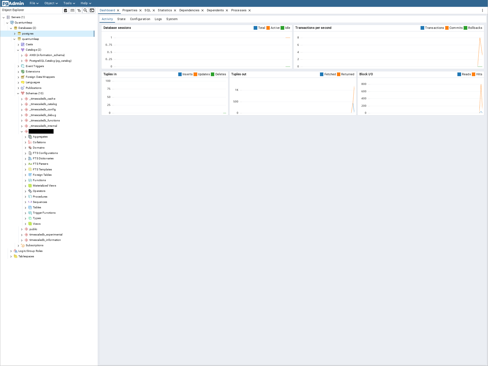
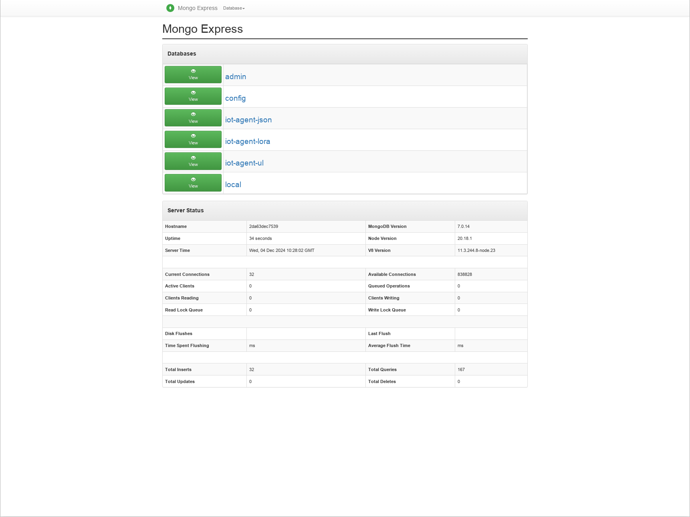

# DB Tooling

To improve database debugging on the production system we added two tools:

- [PGAdmin](https://www.pgadmin.org/)
- [mongo-express](https://github.com/mongo-express/mongo-express)

Both tools are configured to be reachable for external users.

## PGAdmin

PGAdmin is configured to access the postgresql database used by quantumleap. PGAdmin is configured to connect to the database using the same user as grafana to ensure no data can be written.

The dashboard of pgadmin is reachable at: [pgAdmin](https://pgadmin.example.com) or [local](http://localhost:8888) and is secured via basic auth. Passwords are defined in the .env file.

## Mongo-express

Mongo-express is configured to access the mongo database used by all iot agents. It is configured to explicitly prohibit write and delete operations.

The dashboard of mongo-express is reachable at: [Mongo Express](https://mongodb.example.com) or [loca](http://localhost:8083) and is secured via basic auth. Passwords are defined in the .env file.

