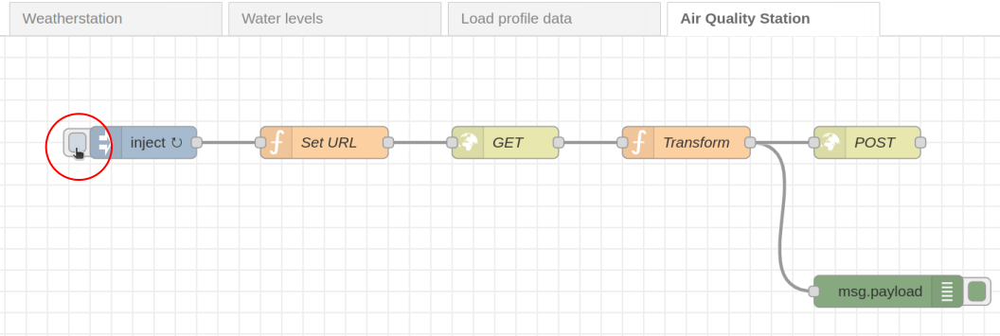
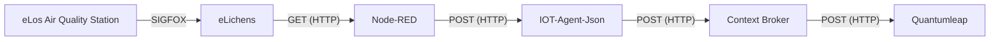

# eLichens eLos Outdoor Air Quality Station

eLos is an autonomous, solar-powered air quality station that transmits data via Sigfox, a low-power, wide-area network (LPWAN) designed for IoT devices.  
We use a [Node-RED](https://nodered.org/) flow to periodically fetch the station data from the [Air Quality eLichens API](https://lab.elichens.com/doc/api#tag/Air-Quality-Station).  
We transform the data format before sending it to the [IoT Agent JSON](https://github.com/telefonicaid/iotagent-json).

In the Node-RED interface, you can manually trigger the data flow by pressing the button shown. This option allows you to immediately fetch and transform data, bypassing the configured interval.



## Data Transformation

Original data format:

```json
{
  "id": "000000000000000000000001",
  "name": "OAQM_18",
  "group_id": "67234709ed452c3fda48f20f",
  "group_name": "Example_Group",
  "serial": "",
  "hardware": null,
  "hardware_id": null,
  "location": {
    "lat": 45.192237,
    "lon": 5.706859
  },
  "type": "elos",
  "status": "online",
  "last_seen": 1730972351,
  "image_url": null,
  "latest_values": {
    "temperature_int": 17.7,
    "temperature": 17.6,
    "pressure": 1017.5,
    "humidity": 60.2,
    "battery": 3805,
    "lux": 0,
    "dB": 33,
    "mslPressure": 1017.5,
    "run_time": 252000,
    "PM2_5": 2,
    "PM10": 10,
    "PM1_0": 2,
    "lqi": 1,
    "nbFrames": 3,
    "CO2": 970,
    "NO2": 21.52042323559,
    "O3": 1.84534961077338
  },
  "latest_values_units": {
    "temperature_int": "degC",
    "temperature": "degC",
    "pressure": "hPa",
    "humidity": "%",
    "battery": "mV",
    "lux": "lux",
    "dB": "dB",
    "mslPressure": "hPa",
    "run_time": "s",
    "PM2_5": "mugPerM3",
    "PM10": "mugPerM3",
    "PM1_0": "mugPerM3",
    "lqi": null,
    "nbFrames": null,
    "CO2": "ppm",
    "NO2": "mugPerM3",
    "O3": "mugPerM3"
  },
  "eid": "37A987",
  "pairing_token": "XXX-XXX-XXX",
  "setting": [],
  "network": [],
  "metadata": {
    "elichens/public/locality": "Grenoble",
    "elichens/public/locality_long": "Grenoble, France"
  }
}
```

Output format:

```json
{
  "ambientLight": 0,
  "atmosphericPressure": 1017.5,
  "batteryCharge": 3805,
  "carbonDioxide": 970,
  "deviceStatus": "online",
  "externalTemperature": 17.6,
  "internalTemperature": 17.7,
  "meanSeaLevelPressure": 1017.5,
  "nitrogenDioxide": 21.52042323559,
  "ozone": 1.84534961077338,
  "particulateMatter1_0": 2,
  "particulateMatter10": 10,
  "particulateMatter2_5": 2,
  "relativeHumidity": 60.2,
  "soundLevel": 33,
  "timestamp": "2024-11-07T09:39:11.000Z"
}
```

## Provisioning and Setup

Once the Node-RED flow was established, we provisioned a new service and device with the specified attributes.  
The init.sh of the IoT agent JSON was modified, and we completed the setup by creating a new subscription with the context broker using a minimalist Node script.

## Attributes

| Attribute              | Type          | Unit    |
| ---------------------- | ------------- | ------- |
| `ambientLight`         | `Float`       | `lx`    |
| `atmosphericPressure`  | `Float`       | `hPa`   |
| `batteryCharge`        | `Float`       | `mV`    |
| `carbonDioxide`        | `Float`       | `ppm`   |
| `deviceStatus`         | `String`      |         |
| `externalTemperature`  | `Float`       | `°C`    |
| `inactive`             | `Boolean`     |         |
| `internalTemperature`  | `Float`       | `°C`    |
| `meanSeaLevelPressure` | `Float`       | `hPa`   |
| `name`                 | `String`      |         |
| `nitrogenDioxide`      | `Float`       | `µg/m³` |
| `ozone`                | `Float`       | `µg/m³` |
| `particulateMatter1_0` | `Float`       | `µg/m³` |
| `particulateMatter10`  | `Float`       | `µg/m³` |
| `particulateMatter2_5` | `Float`       | `µg/m³` |
| `relativeHumidity`     | `Float`       | `%`     |
| `soundLevel`           | `Float`       | `dB`    |
| `timestamp`            | `DateTime`    |         |
| `location`             | `GeoProperty` |         |

## Context

With the types of the attributes a new context was created: [air-quality-station](../../docker-compose/stack/context/custom/air-quality-station.jsonld).

## Data flow


