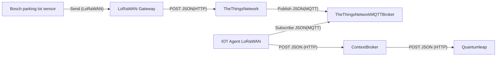

# Bosch parking lot sensor

## Specification and setup

The Bosch parking lot sensor measures, if a vehicle is parked in the parking lot via radar.
The sensor checks its occupancy every 30 s and sends a message via LoRaWAN if the value has changed.
Every 24 h the sensor sends a heartbeat.

According to the documentation the sensor has a self healing and improving algorithm for the detection of vehicles.

## Attributes

| Attribute         | Type          |
| ----------------- | ------------- |
| `debugCodes`      | `String`      |
| `firmwareVersion` | `String`      |
| `inactive`        | `Boolean`     |
| `messageType`     | `String`      |
| `name`            | `String`      |
| `occupied`        | `Boolean`     |
| `resetCause`      | `String`      |
| `location`        | `GeoProperty` |

An example of a transformed payload published via the ttn mqtt Broker for a status update:

```json
{
  "name": "as.up.data.forward",
  "time": "2024-11-05T15:15:19.202714499Z",
  "identifiers": [
    {
      "device_ids": {
        "device_id": "a000000000000011",
        "application_ids": {
          "application_id": "parking-lot-app"
        },
        "dev_eui": "A000000000000012",
        "join_eui": "A000000000000011"
      }
    }
  ],
  "data": {
    "@type": "type.googleapis.com/ttn.lorawan.v3.ApplicationUp",
    "end_device_ids": {
      "device_id": "a000000000000011",
      "application_ids": {
        "application_id": "parking-lot-app"
      },
      "dev_eui": "A000000000000012",
      "join_eui": "A000000000000011"
    },
    "correlation_ids": [
      "as:up:01JBYEA011WZ93JD0VPG4AD8QM",
      "rpc:/ttn.lorawan.v3.AppAs/SimulateUplink:9b680b8b-b6e7-44b8-8b9f-fd2443cc1a73"
    ],
    "received_at": "2024-11-05T15:15:19.199635793Z",
    "uplink_message": {
      "f_port": 1,
      "frm_payload": "AQ==",
      "decoded_payload": {
        "occupied": true,
        "type": "parking status"
      },
      "rx_metadata": [
        {
          "gateway_ids": {
            "gateway_id": "test"
          },
          "rssi": 42,
          "channel_rssi": 42,
          "snr": 4.2
        }
      ],
      "settings": {
        "data_rate": {
          "lora": {
            "bandwidth": 125000,
            "spreading_factor": 7
          }
        },
        "frequency": "868000000"
      },
      "locations": {
        "user": {
          "latitude": 52.52,
          "longitude": 13.405,
          "source": "SOURCE_REGISTRY"
        }
      }
    },
    "simulated": true
  },
  "correlation_ids": [
    "as:up:01JBYEA011WZ93JD0VPG4AD8QM",
    "rpc:/ttn.lorawan.v3.AppAs/SimulateUplink:9b680b8b-b6e7-44b8-8b9f-fd2443cc1a73"
  ],
  "origin": "ip-10-100-14-212.eu-west-1.compute.internal",
  "context": {
    "tenant-id": "CgN0dG4="
  },
  "visibility": {
    "rights": ["RIGHT_APPLICATION_TRAFFIC_READ"]
  },
  "unique_id": "01JBYEA012JGEX0N1P56NFF8CZ"
}
```

## Context

With the types of the attributes a new context was created: [bosch-parking-lot](../../docker-compose/stack/context/custom/bosch-parking-lot.jsonld).

## Payload Formatter

Using the documentation in `parking-lot-sensor-communication-interface.pdf` we implemented a uplink decoder:

```js
function decodeUplink(input) {
  var data = {};
  switch (input.fPort) {
    case 1: // Parking status
      data.type = "parking status";
      data.occupied = (input.bytes[0] & 0x1) === 0x1;
      break;

    case 2: // Heartbeat
      data.type = "heartbeat";
      data.occupied = (input.bytes[0] & 0x1) === 0x1;
      break;

    case 3: // Start-up
      data.type = "startup";
      data.debugCodes = [];
      for (var i = 0; i <= 8; i += 4) {
        var debugCode = ((input.bytes[i + 1] & 0xf) << 8) | input.bytes[i];
        if (debugCode) {
          data.debugCodes.push(debugCode);
        }
      }
      data.firmwareVersion =
        input.bytes[12] + "." + input.bytes[13] + "." + input.bytes[14];
      data.resetCause = [
        undefined,
        "watchdog",
        "power on",
        "system request",
        "other",
      ][input.bytes[15]];
      data.occupied = (input.bytes[16] & 0x1) == 0x1;
      break;
  }

  return {
    data: data,
  };
}
```

## Data Flow



## Mocking data

The `Messaging`/`Simulate uplink` function of the end device on the theThingsNetwork console can be used to simulate new messages.
To simulate a new status update for the parking lot:

FPort: 1
Payload: 04

Or simulate a available parking lot:

FPort: 1
Payload: 02 00 08 00 01 03 E9 **00** 02 77 55
