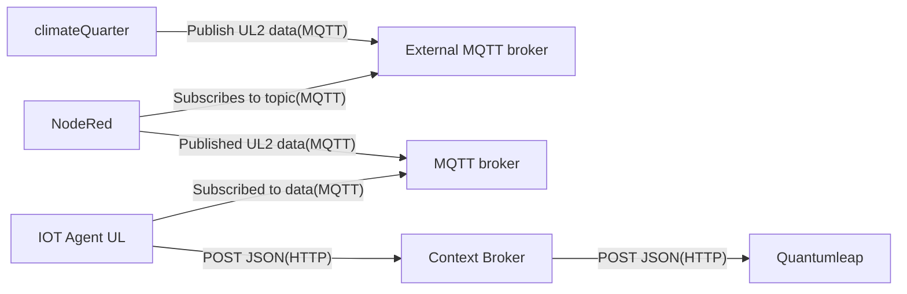

# Climate Quarter House

The “Klimaviertel” (Climate Quarter) is an innovative residential project. This project
consists of seven single-family homes, each designed to achieve near-total energy self-sufficiency. Equipped with
photovoltaic systems, batteries, and geothermal heat pumps, these homes aim to minimize environmental impact and provide
a sustainable living solution.

## Specification and Setup

Data from the Climate Quarter is transmitted via MQTT to an external MQTT broker (`CLIMATE_QUARTER_MQTT_URL` in `.env`). In Node-RED a Flow was
configured to subscribe to all topics from this broker and republishes them to the MQTT broker within this stack.
The IoT Agent UL listens to all topics matching:

```js
/ul/<apiKey>/<deviceId>/attrs
```

For more details, refer to
the [IoT Agent UL Documentation](https://github.com/telefonicaid/iotagent-ul/blob/master/docs/usermanual.md)

## Attributes

Below is an example of an Ultralight 2.0 message sent to the IoT Agent UL:

```ul
2024-11-07T11:12:51Z|hp.r_cop|0.00|hp.r_prcond|12.40|hp.r_prevap|10.20|hp.r_prccp|0.00|hp.r_prchsp|0.00|hp.r_prcteev|0.00|hp.r_tempout1|5.00|hp.r_tempsucg|14.40|logvar.b_5|0|logvar.b_6|0|logvar.b_extwe|0|logvar.b_gsiv1|0|logvar.b_gsiv2|0|logvar.b_v_ww|0|logvar.di_ptherm_hzg|0|logvar.di_ptherm_wp|0|logvar.di_ptherm_ww|0|logvar.di_p_5|0|logvar.di_p_6|null|logvar.di_p_7|0|logvar.di_p_8|0|logvar.di_p_bat_ac|-9999|logvar.di_p_batt|198|logvar.di_p_batt_dc|-9999|logvar.di_p_batt_pump|-9999|logvar.di_p_batt_soc|4|logvar.di_p_booster|null|logvar.di_p_comp|0|logvar.di_p_eheiz|0|logvar.di_p_haus|249|logvar.di_p_netz|-18|logvar.di_p_netz2|0|logvar.di_p_pheizung|null|logvar.di_p_pquelle|null|logvar.di_p_solar|465|logvar.di_p_tww_ecopac|null|logvar.di_p_vent|null|logvar.di_p_w2|0|logvar.di_p_wp|0|logvar.i_2|0|logvar.i_3|0|logvar.i_batt_cyc|0|logvar.i_count_start_comp|4416|logvar.r_temp_abl|0.00|logvar.r_temp_aul|0.00|logvar.r_temp_aussen|5.20|logvar.r_temp_aussen24h|5.60|logvar.r_temp_fol|0.00|logvar.r_temp_gsigia|0.00|logvar.r_temp_gsigia_ret|24.97|logvar.r_temp_gsisa|0.00|logvar.r_temp_gsisa_ret|24.97|logvar.r_temp_qaus|10.10|logvar.r_temp_qaus_epb|24.97|logvar.r_temp_qein|10.40|logvar.r_temp_qein_epb|24.97|logvar.r_temp_raum|-40.00|logvar.r_temp_rl|25.10|logvar.r_temp_rlsoll|25.70|logvar.r_temp_vl|25.40|logvar.r_temp_wwist|-40.00|logvar.r_temp_wwsoll|55.00|logvar.r_temp_zul|0.00|logvar.w_5052_do_bm_e1|0|logvar.w_5053_error_e1|0|logvar.w_5054_inte1|0|logvar.w_5055_do_bm_e1|1|i_housenum|14|logvar.r_p_booster|9.55|logvar.r_p_pheizung|0.48|logvar.r_p_pquelle|0.44|logvar.r_p_tww_ecopack|0.00|logvar.r_p_vent|0.00|logvar.r_hm_flow|null|logvar.r_hm_tempa|null|logvar.r_hm_tempb|null|logvar.r_hm_tempdiff|null|logvar.r_hm_sum|null
```

The init.sh script initializes the provisioning to create the configuration group and add devices.

The following table provides a list of attributes with meaningful names and specified data types:

| Object ID                   | Name                                    | Type      |
| --------------------------- | --------------------------------------- | --------- |
|                             | `inactive`                              | `Boolean` |
|                             | `name`                                  | `String`  |
| `hp.r_cop`                  | `heatPumpCoefficientOfPerformance`      | `Float`   |
| `hp.r_prccp`                | `heatingPumpControlPercentage`          | `Float`   |
| `hp.r_prchsp`               | `sourcePumpControlPercentage`           | `Float`   |
| `hp.r_prcond`               | `condensationPressure`                  | `Float`   |
| `hp.r_prcteev`              | `expansionValveOpeningDegree`           | `Float`   |
| `hp.r_prevap`               | `evaporationPressure`                   | `Float`   |
| `hp.r_tempout1`             | `outsideTemperature1hAverage`           | `Float`   |
| `hp.r_tempsucg`             | `suctionGasTemperature`                 | `Float`   |
| `i_housenum`                | `houseNumber`                           | `Integer` |
| `logvar.b_5`                | `reserve5`                              | `Float`   |
| `logvar.b_6`                | `reserve6`                              | `Float`   |
| `logvar.b_extwe`            | `electricHeatingControl`                | `Integer` |
| `logvar.b_gsiv1`            | `groundAbsorberValveControl`            | `Integer` |
| `logvar.b_gsiv2`            | `solarAbsorberValveControl`             | `Integer` |
| `logvar.b_v_ww`             | `hotWaterValveControl`                  | `Integer` |
| `logvar.di_p_5`             | `powerReserve5`                         | `Float`   |
| `logvar.di_p_6`             | `powerReserve6`                         | `Float`   |
| `logvar.di_p_7`             | `powerReserve7`                         | `Float`   |
| `logvar.di_p_8`             | `powerReserve8`                         | `Float`   |
| `logvar.di_p_bat_ac`        | `batteryPowerAC`                        | `Float`   |
| `logvar.di_p_batt_dc`       | `batteryPowerDC`                        | `Float`   |
| `logvar.di_p_batt_pump`     | `batteryPumpPower`                      | `Float`   |
| `logvar.di_p_batt_soc`      | `batteryStateOfCharge`                  | `Float`   |
| `logvar.di_p_batt`          | `batteryPowerEcoPowerStation`           | `Float`   |
| `logvar.di_p_booster`       | `ecoPowerBoosterPower`                  | `Float`   |
| `logvar.di_p_comp`          | `powerReserveComp`                      | `Float`   |
| `logvar.di_p_eheiz`         | `electricHeatingPower`                  | `Float`   |
| `logvar.di_p_haus`          | `powerHouseConsumption`                 | `Float`   |
| `logvar.di_p_netz`          | `powerGrid`                             | `Float`   |
| `logvar.di_p_netz2`         | `powerGridReserve2`                     | `Float`   |
| `logvar.di_p_pheizung`      | `heatingPumpPower`                      | `Float`   |
| `logvar.di_p_pquelle`       | `sourcePumpPower`                       | `Float`   |
| `logvar.di_p_solar`         | `powerPV`                               | `Float`   |
| `logvar.di_p_tww_ecopac`    | `ecoPackDrinkingWaterStationPower`      | `Float`   |
| `logvar.di_p_vent`          | `ventilationPower`                      | `Float`   |
| `logvar.di_p_w2`            | `heatPumpReservePower2`                 | `Float`   |
| `logvar.di_p_wp`            | `heatPumpPower`                         | `Float`   |
| `logvar.di_ptherm_hzg`      | `heatingThermalPower`                   | `Float`   |
| `logvar.di_ptherm_wp`       | `heatPumpThermalPower`                  | `Float`   |
| `logvar.di_ptherm_ww`       | `hotWaterThermalPower`                  | `Float`   |
| `logvar.i_2`                | `reserveI2`                             | `Float`   |
| `logvar.i_3`                | `reserveI3`                             | `Float`   |
| `logvar.i_batt_cyc`         | `batteryChargeCycles`                   | `Integer` |
| `logvar.i_count_start_comp` | `compressorStartCount`                  | `Integer` |
| `logvar.r_hm_flow`          | `heatMeterFlowRate`                     | `Float`   |
| `logvar.r_hm_sum`           | `totalHeatAmount`                       | `Float`   |
| `logvar.r_hm_tempa`         | `heatMeterTemperatureA`                 | `Float`   |
| `logvar.r_hm_tempb`         | `heatMeterTemperatureB`                 | `Float`   |
| `logvar.r_hm_tempdiff`      | `heatMeterTemperatureDifference`        | `Float`   |
| `LogVar.r_HM_Wtherm`        | `boosterHotWaterThermalPower`           | `Float`   |
| `logvar.r_p_booster`        | `boosterThermalPower`                   | `Float`   |
| `logvar.r_p_pheizung`       | `heatingPumpThermalPower`               | `Float`   |
| `logvar.r_p_pquelle`        | `sourcePumpThermalPower`                | `Float`   |
| `logvar.r_p_tww_ecopack`    | `ecoPackDrinkingWaterThermalPower`      | `Float`   |
| `logvar.r_p_vent`           | `ventilationThermalPower`               | `Float`   |
| `logvar.r_temp_abl`         | `ventilationReturnAirTemperature`       | `Float`   |
| `logvar.r_temp_aul`         | `ventilationOutsideAirTemperature`      | `Float`   |
| `logvar.r_temp_aussen`      | `currentOutsideTemperature`             | `Float`   |
| `logvar.r_temp_aussen24h`   | `outsideTemperature24hAverage`          | `Float`   |
| `logvar.r_temp_fol`         | `ventilationExhaustAirTemperature`      | `Float`   |
| `logvar.r_temp_gsigia_ret`  | `trenchCollectorReturnTemperature`      | `Float`   |
| `logvar.r_temp_gsigia`      | `trenchCollectorSupplyTemperature`      | `Float`   |
| `logvar.r_temp_gsisa_ret`   | `solarAbsorberReturnTemperature`        | `Float`   |
| `logvar.r_temp_gsisa`       | `solarAbsorberSupplyTemperature`        | `Float`   |
| `logvar.r_temp_qaus_epb`    | `ecoPowerBoosterSourceExitTemperature`  | `Float`   |
| `logvar.r_temp_qaus`        | `sourceExitTemperature`                 | `Float`   |
| `logvar.r_temp_qein_epb`    | `ecoPowerBoosterSourceEntryTemperature` | `Float`   |
| `logvar.r_temp_qein`        | `sourceEntryTemperature`                | `Float`   |
| `logvar.r_temp_raum`        | `roomAirTemperature`                    | `Float`   |
| `logvar.r_temp_rl`          | `returnTemperature`                     | `Float`   |
| `logvar.r_temp_rlsoll`      | `returnTemperatureSetpoint`             | `Float`   |
| `logvar.r_temp_vl`          | `flowTemperature`                       | `Float`   |
| `logvar.r_temp_wwist`       | `currentHotWaterTemperature`            | `Float`   |
| `logvar.r_temp_wwsoll`      | `hotWaterTemperatureSetpoint`           | `Float`   |
| `logvar.r_temp_zul`         | `ventilationSupplyAirTemperature`       | `Float`   |
| `logvar.w_5052_do_bm_e1`    | `heatPumpSwitchingState1`               | `Integer` |
| `logvar.w_5053_error_e1`    | `heatPumpErrorE1`                       | `Integer` |
| `logvar.w_5054_inte1`       | `heatPumpInterruptions`                 | `Integer` |
| `logvar.w_5055_do_bm_e1`    | `heatPumpSwitchingState1Duplicate`      | `Integer` |

## Context

Based on the attribute types, a new context has been
created: : [climate-quarter-house](../../docker-compose/stack/context/custom/climate-quarter-house.jsonld).

## Data flow


