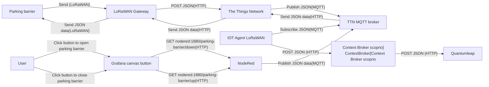

# DO300 Parking barrier

The functionality of the parking barrier is described in `DO300-Parking-Lock-User-manual-LoRaWAN-V1.0.pdf` chapter `3 Working Principle`:

1. The siren (buzzer) and led light will work for 2s at the initial power-on, and the device will open the lock after 2s; at this time, the device starts to work normally;
2. The device will join network. After joined successfully, the device will report
   the basic information of the device, including the current car lock status, battery voltage,etc.; Then enter the sleep state and wait for the platform to release control commands;
3. When receiving the unlock command issued by the platform, the device will
   respond to the current device status of the platform, and at the same time, start
   the ultrasonic detection at 10s intervals (time can be configured);
4. When the vehicle enters, if the ultrasonic detection is valid for 2 or more times, the parking space will be occupied, and the current vehicle status will be reported and the vehicle occupation detection mode will be activated (the ultrasonic will be detected at 20s intervals);
5. When the vehicle leaves, if the ultrasonic detection is valid for 2 times or more, the vehicle enters the idle state, at the same time, the lock is closed, and the current parking space status is reported. At this time, the working mode is switched to the idle mode, waiting for the next vehicle entry;
6. By default, the device reports the current network status, parking status, current battery level and other information once in 24h;

We were able to reproduce the described behavior with the exception, that the duration between step 4 and 5 takes more time then described.

## Provisioning and Setup

Once the Node-RED flow was established, we provisioned a new service and device with the specified attributes. The `init.sh` of the IoT agent LoRaWAN was modified, and we completed the setup by creating a new subscription with the context broker using a minimalist Node script.

## Data

### Attributes

We decided to use the following attributes:

| Attribute         | Type          | UnitCode |
| ----------------- | ------------- | -------- |
| `batteryCapacity` | `Number`      | P1       |
| `deviceId`        | `String`      |          |
| `inactive`        | `Boolean`     |          |
| `location`        | `GeoProperty` |          |
| `locked`          | `Boolean`     |          |
| `name`            | `String`      |          |
| `occupied`        | `Boolean`     |          |
| `online`          | `Boolean`     |          |
| `voltage`         | `Number`      | VLT      |

### Context

With the types of the attributes a new context was created: [parking-barrier](../../docker-compose/stack/context/custom/parking-barrier.jsonld).

### Payload Formatter

Using the documentation in `DO300-Parking-Lock-Protocol_LoRaWan_V1.1.pdf` we implemented a uplink decoder:

```js
function decodeUplink(input) {
  // Initialisiere die Rückgabeobjekte
  let data = {};
  let warnings = [];
  let errors = [];

  // Extrahiere die Bytes aus dem Input
  const bytes = input.bytes;

  // Funktion zum Konvertieren von zwei Bytes zu einem Unsigned Integer (Big Endian)
  function bytesToUInt16(byte1, byte2) {
    return (byte1 << 8) | byte2;
  }

  // Überprüfe das erste Byte, um den Packett-Typ zu bestimmen
  const packetType = bytes[0];

  if (packetType === 0x02) {
    // Upload-Paket
    if (bytes.length < 6) {
      errors.push("Unzureichende Länge für Upload-Paket");
      return { data, warnings, errors };
    }

    const payloadLength = bytesToUInt16(bytes[1], bytes[2]);
    const msgid = bytesToUInt16(bytes[3], bytes[4]);
    const serviceId = bytesToUInt16(bytes[5], bytes[6]);

    if (serviceId === 0x03e9) {
      // Service ID 1001: Upload Information
      if (bytes.length < 10) {
        errors.push("Unzureichende Länge für Upload Information");
        return { data, warnings, errors };
      }

      const parkingStatus = bytes[7];
      const voltageRaw = bytesToUInt16(bytes[8], bytes[9]);
      const batteryCapacityRaw = bytes[10];

      data.occupied = parkingStatus === 0x01;
      data.locked = data.Occupied; // Annahme: Gesperrt, wenn besetzt

      // Spannung berechnen (z.B. 0x0277 = 631 -> 6.31 V)
      data.voltage = voltageRaw / 100;

      // Batteriekapazität berechnen (basierend auf Beschreibung: 0x55 = 85 entspricht 83%)
      data.batteryCapacity = Math.round((batteryCapacityRaw / 0x55) * 83);
    } else if (serviceId === 0x03ea) {
      // Service ID 1002: Report Parameter
      // Diese Parameter werden nicht für die gewünschten Felder benötigt
      // Optional: Weitere Verarbeitung hier
    }
  } else if (packetType === 0x83) {
    // Antwort auf Downlink-Befehl
    if (bytes.length < 8) {
      errors.push("Unzureichende Länge für Antwort auf Downlink");
      return { data, warnings, errors };
    }

    const payloadLength = bytesToUInt16(bytes[1], bytes[2]);
    const msgid = bytesToUInt16(bytes[3], bytes[4]);
    const serviceId = bytesToUInt16(bytes[5], bytes[6]);
    const code = bytes[7];

    if (code !== 0x0001) {
      warnings.push("Befehl wurde nicht erfolgreich ausgeführt");
    }

    if (serviceId === 0x2329) {
      // Service ID 9001: Replying Parking Status
      if (bytes.length < 9) {
        errors.push("Unzureichende Länge für Parking Status Antwort");
        return { data, warnings, errors };
      }

      const parkingStatus = bytes[8];
      data.occupied = parkingStatus === 0x01;
      data.locked = data.Occupied; // Annahme: Gesperrt, wenn besetzt
    } else if (serviceId === 0x232e) {
      // Service ID 9006: Replying Voltage Information
      if (bytes.length < 13) {
        errors.push("Unzureichende Länge für Voltage Information Antwort");
        return { data, warnings, errors };
      }

      const voltageRaw = bytesToUInt16(bytes[8], bytes[9]);
      const batteryCapacityRaw = bytes[10];

      data.voltage = voltageRaw / 100;
      data.batteryCapacity = Math.round((batteryCapacityRaw / 0x55) * 85);
    } else if (serviceId === 0x232a) {
      // Service ID 9002: Replying Time Parameter
      // Diese Parameter werden nicht für die gewünschten Felder benötigt
      // Optional: Weitere Verarbeitung hier
    }
  } else if (packetType === 0x04) {
    // Heartbeat-Paket
    data.online = true;
  } else {
    warnings.push("Unbekannter Packett-Typ");
  }

  return {
    data: data,
    warnings: warnings,
    errors: errors,
  };
}
```

We did not add any Downlink Payload formatters, since we already know the data in the payload.

## Data Flow



## Mocking data

The `Messaging`/`Schedule downlink` function of the end device on the theThingsNetwork console can be used to simulate new messages.
To simulate a new status update for the parking lot:

Insert Mode: `Replace downlink queue`
FPort: 1
Payload Type: `Bytes`
Payload: 04

## Sending commands

This sensor does not only collect data but also as an active element to open/close the parking barrier. To control this active element we can also use the mqtt integration and push/replace data in the downlink queue. To improve speed we decided to go with replacing the data in the downlink queue since only our application should send data to the downlink queue.

Due to a bug in the grafana button component this currently does only work for one parking barrier until the [issue is resolved](https://github.com/grafana/grafana/issues/82041).

## Downlinks data crafting

The Downlink data needs to contain the payload as base64 encoded. There is a online tool to do so:
https://v2.cryptii.com/hexadecimal/base64

**Simulate Heartbeat to update `online` property**

Simulate uplink via TTN Messaging:

FPort: 01
Payload: 04

**Simulate Status to update `locked, batteryCapacity, occupied and voltage` properties**

Simulate Uplink via TTN Messaging:

FPort: 01
Payload: 020008000103E900027755

### Control station via mqtt clients

**Open parking barrier**

```sh
mosquitto_pub -h eu1.cloud.thethings.network -p 1883 \
  -t "v3/parking-barrier-app@ttn/devices/a000000000000005/down/push" \
  -u "parking-barrier-app@ttn" -P "$LORA_PARKING_BARRIER_APPLICATION_PASSWORD" \
  -m '{"downlinks":[{"f_port": 1,"frm_payload":"AwAFAEcfQQA=","priority": "NORMAL"}]}' \
  -d
```

**Close parking barrier**

```sh
mosquitto_pub -h eu1.cloud.thethings.network -p 1883 \
  -t "v3/parking-barrier-app@ttn/devices/a000000000000005/down/push" \
  -u "parking-barrier-app@ttn" -P "$LORA_PARKING_BARRIER_APPLICATION_PASSWORD" \
  -m '{"downlinks":[{"f_port": 1,"frm_payload":"AwAFAEcfQQE=","priority": "NORMAL"}]}' \
  -d
```
