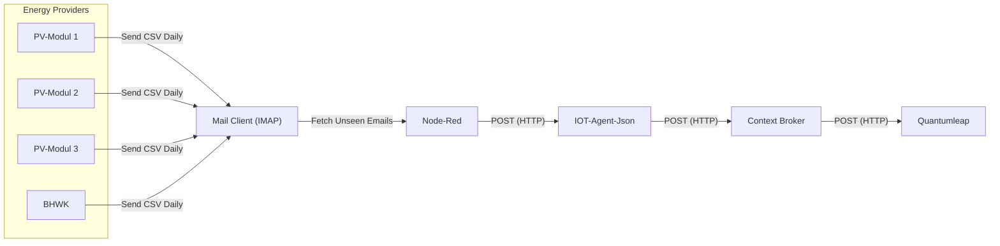

# Load profile data

For each energy provider connected to the municipal utility, a CSV file is sent daily at 11:00 AM via email, containing data on energy generation and consumption.  
We use a [Node-RED](https://nodered.org/) flow to automatically check the email inbox for unread emails with CSV attachments.  
Once an email is retrieved, it is marked as read, then the CSV data is parsed, transformed into a JSON format, and posted to the [IoT Agent JSON](https://github.com/telefonicaid/iotagent-json).

## Provisioning and Setup

Once the Node-RED flow was established, we provisioned a new service and device with the specified attributes.  
The init.sh of the IoT agent JSON was modified, and we completed the setup by creating a new subscription with the context broker using a minimalist Node script.

## Attributes

| Attribute                   | Type       | Unit    |
| --------------------------- | ---------- | ------- |
| `meterPoint`                | `String`   |         |
| `timestamp`                 | `DateTime` |         |
| `activeConsumption`         | `Float`    | `kWh`   |
| `statusActiveConsumption`   | `Boolean`  |         |
| `reactiveConsumption`       | `Float`    | `kvarh` |
| `statusReactiveConsumption` | `Boolean`  |         |
| `activeFeed`                | `Float`    | `kWh`   |
| `statusActiveFeed`          | `Boolean`  |         |
| `reactiveFeed`              | `Float`    | `kvarh` |
| `statusReactiveFeed`        | `Boolean`  |         |
| `name`                      | `String`   |         |
| `inactive`                  | `Boolean`  |         |

## Context

With the types of the attributes a new context was created: [energy-meter](../../docker-compose/stack/context/custom/energy-meter.jsonld).

## Data flow

