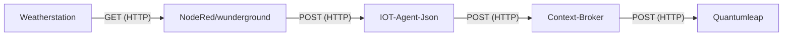

# Froggit WH 4000 Se

The weather station froggit wh 4000 se was manufacturer by froggit but sale has now been discontinued.
Hardware consists of one weather station and a basis station, both are connected via a 2.4Ghz wifi. Once the station is configured via the app it sends recorded data as [weather underground data](https://www.wunderground.com/about/data).

## Specification and setup

The base stations of the weather station sends its data on a configured time interval as JSON via HTTP Post to a custom endpoint. We selected the minimal interval of 8 and configured the station to send its data to our nodered application. We added a new flow to NodeRed to convert the GET request of the station to a post containing the GET parameters.

To do so we recorded the get request the station sends:

```http
GET
ID=Ws021&PASSWORD=TestKey&indoortempf=77.2&tempf=75.6&dewptf=50.9&windchillf=75.6&indoorhumidity=43&humidity=42&windspeedmph=0.0&windgustmph=0.0&winddir=137&absbaromin=29.419&baromin=29.419&rainin=0.000&dailyrainin=0.012&weeklyrainin=0.012&monthlyrainin=0.012&yearlyrainin=0.012&solarradiation=12.97&UV=0&dateutc=2024-08-22%2012:37:52&softwaretype=EasyWeatherV1.6.9&action=updateraw&realtime=1&rtfreq=5 HTTP/1.1
Host: 192.168.1.50
Accept:*/*
Connection: Close
```

The IOT Agent Json expects a POST request so we have to transform the data.
To do so we had this options:

- NestJS
- n8n.io
- nodeRed

The decision is documented in [Dependency decision](/docs/workflow-automation/README.md).

The new flow listens on `/wunderground` for new requests then takes the parameters and creates a post requests to the iot agent json url.

Once the NodeFlow was in place we had to provision a new service and device with the supplied attributes. We modified the `init.sh` of the iot agent json and finished the setup by creating a new subscription with the context broker using a minimalist node script.

## Attributes

| Attribute              | Type          | Expression                                                 | Unit       |
| ---------------------- | ------------- | ---------------------------------------------------------- | ---------- |
| `atmosphericPressure`, | `Float`       |                                                            |            |
| `barOMin`,             | `Float`       | `barOMin\*33.86388`                                        | `hPa/mbar` |
| `dailyRainIn`,         | `Float`       |                                                            |            |
| `dateObserved`,        | `DateTime`    | `substr(dateObserved, 0, 10)Tsubstr(dateObserved, 11, 8)Z` |            |
| `dewPoint`,            | `Float`       | `(dewPoint-32)\*5/9`                                       | `°C`       |
| `gustSpeed`,           | `Float`       | `gustSpeed\*0.44704`                                       | `km/h`     |
| `inactive`,            | `Boolean`     |                                                            |            |
| `indoorHumidity`,      | `Float`       |                                                            |            |
| `indoorTemperature`,   | `Float`       | `(indoorTemperature-32)\*5/9`                              | `°C`       |
| `location`,            | `GeoProperty` |                                                            |            |
| `monthlyRainIn`,       | `Float`       |                                                            |            |
| `name`,                | `String`      |                                                            |            |
| `precipitation`,       | `Float`       | `precipitation\*25.4`                                      |            |
| `realTime`,            | `Float`       |                                                            |            |
| `relativeHumidity`,    | `Float`       |                                                            |            |
| `rtFreq`,              | `Float`       |                                                            |            |
| `softwareType`,        | `String`      |                                                            |            |
| `solarRadiation`,      | `Float`       |                                                            |            |
| `temperature`,         | `Float`       | `(temperature-32)\*5/9`                                    | `°C`       |
| `uvIndex`,             | `Float`       |                                                            |            |
| `weeklyRainIn`,        | `Float`       |                                                            |            |
| `windChill`,           | `Float`       | `(windChill-32)\*5/9`                                      | `°C`       |
| `windDirection`,       | `Float`       |                                                            |            |
| `windSpeed`,           | `Float`       | `windSpeed\*0.44704`                                       | `km/h`     |
| `yearlyRainIn`,        | `Float`       |                                                            |            |

## Context

With the types of the attributes a new context was created: [froggit-wh-4000-se](../../docker-compose/stack/context/custom/froggit-wh-4000-se.jsonld).

## Data flow


