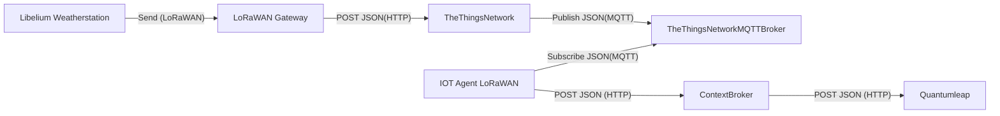

# Libelium smart agriculture xtreme weather stations

## Specification and setup

The Plug & Sense base station has connectors for several different sensors. Currently there are three sensors connected:

- AMS TSL2561 Luminosity Sensor Probe
- Bosch BME280 Temperature/Humidity/Pressure sensor
- MaxiMet weather station [GMX250](https://www.libelium.com/wp-content/uploads/2018/08/MaxiMet-table.pdf)

The sensors needs to be connected to [specific ports](https://development.libelium.com/plug-and-sense-technical-guide/models) of the base station described.
All data are transferred via LoRaWAN to the gateway and then send to the [theThingsNetwork](https://www.thethingsnetwork.org/).
There is a very useful [wiki](https://development.libelium.com/plug-and-sense) describing all features of this station.

To use the connected sensors the plug & sense base stations logic needs to be updated via a custom firmware image. We used the already available program from: `https://github.com/scilabs-bo/Libelium-SAXtreme-Weather-Station`. Users need to be aware, that the new firmware might contain different values for:

- DEVICE_EUI
- APP_EUI
- APP_KEY

then the supplier has defined.

An example of a transformed payload published via the ttn mqtt Broker:

```json
{
  "end_device_ids": {
    "device_id": "a000000000000004",
    "application_ids": { "application_id": "weather-app" },
    "dev_eui": "A000000000000004",
    "join_eui": "A000000000000010",
    "dev_addr": "260B9817"
  },
  "correlation_ids": ["gs:uplink:01JBY6EDXDJVFS2BSCDFRJAVAB"],
  "received_at": "2024-11-05T12:57:56.093717344Z",
  "uplink_message": {
    "session_key_id": "AZL7XljJwLSQ26q7QdamwQ==",
    "f_port": 1,
    "f_cnt": 51,
    "frm_payload": "mpdAuMKAAAAAAA==",
    "decoded_payload": {
      "correctedWindDirection": 0,
      "event": "all data",
      "humidity": 46,
      "luminosity": 3890,
      "precipitationIntensity": 0,
      "pressure": 1007.1,
      "temperature": 21.8,
      "windDirection": 0,
      "windSpeed": 0
    },
    "rx_metadata": [
      {
        "gateway_ids": {
          "gateway_id": "example-gateway",
          "eui": "A84041FFFF21D000"
        },
        "time": "2024-11-05T12:57:55.852300Z",
        "timestamp": 1472470348,
        "rssi": -45,
        "channel_rssi": -45,
        "snr": 11.2,
        "uplink_token": "<uplink-token>",
        "channel_index": 1,
        "received_at": "2024-11-05T12:57:55.865119909Z"
      }
    ],
    "settings": {
      "data_rate": {
        "lora": {
          "bandwidth": 125000,
          "spreading_factor": 8,
          "coding_rate": "4/5"
        }
      },
      "frequency": "868300000",
      "timestamp": 1472470348,
      "time": "2024-11-05T12:57:55.852300Z"
    },
    "received_at": "2024-11-05T12:57:55.885757893Z",
    "consumed_airtime": "0.113152s",
    "locations": {
      "user": {
        "latitude": 52.52,
        "longitude": 13.405,
        "source": "SOURCE_REGISTRY"
      }
    },
    "network_ids": {
      "net_id": "000013",
      "ns_id": "EC656E0000000181",
      "tenant_id": "ttn",
      "cluster_id": "eu1",
      "cluster_address": "eu1.cloud.thethings.network"
    }
  }
}
```

## Attributes

| Attribute                | Type          | Unit       |
| ------------------------ | ------------- | ---------- |
| `temperature`            | `Float`       | `°C`       |
| `humidity`               | `Float`       |            |
| `pressure`               | `Float`       | `hPa/mbar` |
| `luminosity`             | `Float`       |            |
| `windDirection`          | `Float`       |            |
| `correctedWindDirection` | `Float`       |            |
| `windSpeed`              | `Float`       | `km/h`     |
| `name`                   | `String`      | `km/h`     |
| `inactive`               | `Boolean`     | `km/h`     |
| `precipitationIntensity` | `Float`       |            |
| `location`               | `GeoProperty` |            |

## Context

With the types of the attributes a new context was created: [libelium-weather](../../docker-compose/stack/context/custom/libelium-weather.jsonld).

## Payload Formatter

```js
//  According to the Axioma Payload Documentation Release 2020-04-06 V01.8
//  Implemented by Andreas Kulla
//  2022-03
//  Ver 0.1

function decodeUplink(input) {
  var data = {};
  var encoded = {};
  var events = {
    1: "all data",
    2: "config params",
    3: "alarm",
  };
  // var bytes = input.bytes.length;

  data.event = events[input.fPort];
  if (input.fPort === 1) {
    encoded.bytelength = input.bytes.length;

    encoded.temperature = (input.bytes[0] << 2) | (input.bytes[1] >> 6);
    encoded.humidity =
      ((input.bytes[1] & 0b00111111) << 1) | (input.bytes[2] >> 7);
    encoded.pressure =
      ((input.bytes[2] & 0b01111111) << 5) | (input.bytes[3] >> 3);
    encoded.luminosity =
      ((input.bytes[3] & 0b00000111) << 10) |
      (input.bytes[4] << 2) |
      (input.bytes[5] >> 6);
    encoded.windDirection = input.bytes[5] & 0b00111111;
    encoded.correctedWindDirection = input.bytes[6] >> 2;
    encoded.windSpeed = ((input.bytes[6] & 0b00000011) << 8) | input.bytes[7];
    encoded.precipitationIntensity =
      (input.bytes[8] << 4) | (input.bytes[9] >> 4);

    data.temperature = (encoded.temperature - 400) / 10;
    data.humidity = encoded.humidity;
    data.pressure = (encoded.pressure + 8000) * 0.1;
    data.luminosity = encoded.luminosity * 5;
    data.windDirection = encoded.windDirection * 10;
    data.correctedWindDirection = encoded.correctedWindDirection * 10;
    data.windSpeed = encoded.windSpeed / 10;
    data.precipitationIntensity = encoded.precipitationIntensity / 10;
  }

  return {
    data: data,
    warnings: [],
    errors: [],
  };
}
```

## Data Flow



## Mocking data

The `Messaging`/`Simulate uplink` function of the end device on the theThingsNetwork console can be used to simulate new messages.

To simulate a new status update for the weather station:

FPort: 1
Payload: 11 11

For further information on mocking LoRaWAN data refer to [##Mocking data](../lorawan/README.md]).
