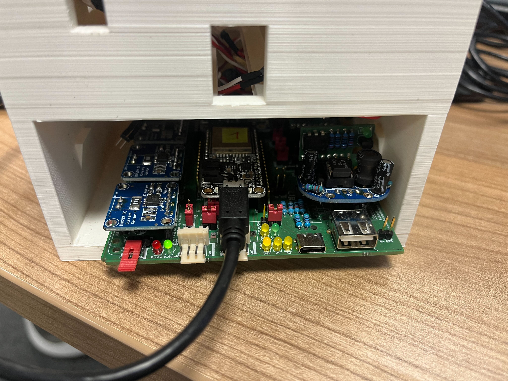
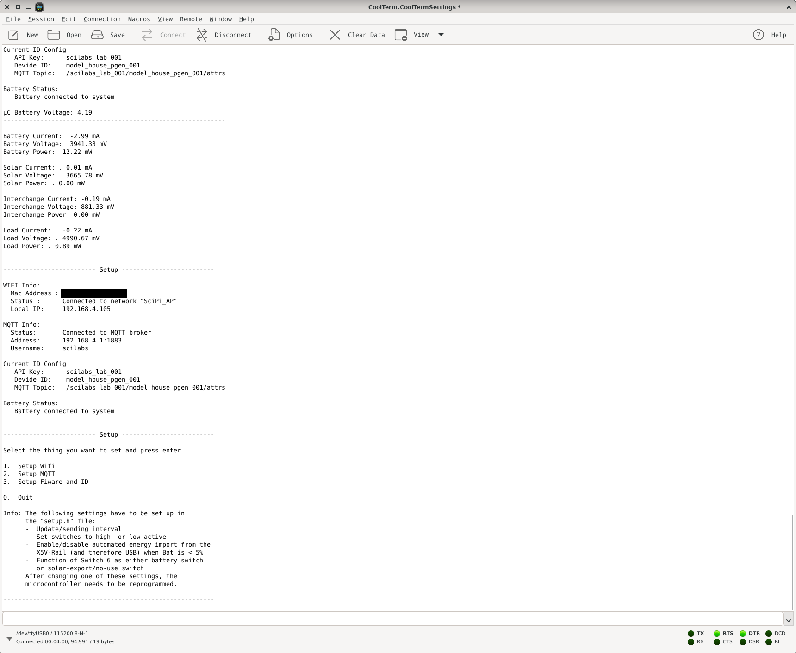
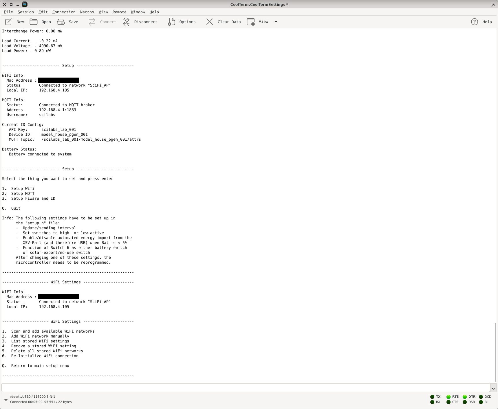
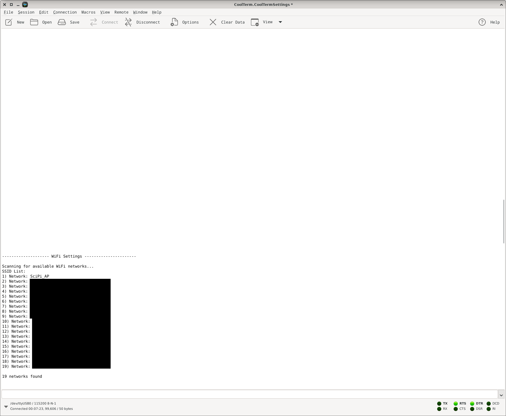
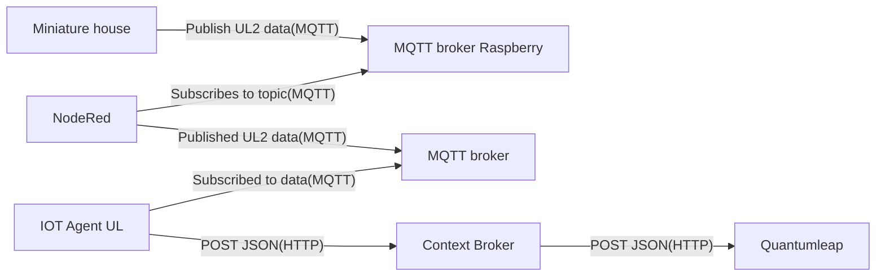

# Miniature house

The "miniature house" is 3d printed miniature version of a house controlled by an esp32 to simulate a smart city use case. It is used for workshops.
The house has a solar module and, a battery, a energy exchange system to supply other miniature houses with power and a loading port for a miniature car.
All data tracked by the esp32 are published as UL2 via MQTT. To do so the house connects to an mqtt broker running on an raspberry via wifi. There are two mqtt brokers serving 14 miniature houses. Due to the workshop environment we did decide to not send data to a deployed stack but instead start the FiWare stack local.

## Setup

We have to make sure, all requirements are met:

- SD card holding the prepared Raspberry Pi image
- raspberry & power supply via usb-c
- miniature house
- micro USB Cable
- [CoolTerm](https://freeware.the-meiers.org/) or another serial terminal software is installed
- FiWare Stack up and running (local)

To start the setup we supply the raspberry and the miniature house with power. The Raspberry has a red led and the esp32 in the miniature house has a yellow led on the right side of the micro usb port and a red led on the left side to indicate operation.



Then we can start to configure the wifi connection between the miniature house and the raspberry via the serial terminal. To do so we have to power up CoolTerm with the provided configuration located in: `CoolTerm.CoolTermSettings`. Once the device is powered up we can send `setup` to start the configuration:



Then we can configure wifi by sending `1`



Then we can select one of two networks:
Password: `<wifi-password>`
SSIDs: Scipi_AP1 / Scipi_AP2



Once that is done the miniature house connects to the raspberry and starts publishing data via mqtt.

Now we also connect to the wifi and subscribe to the published data:

```sh
mosquitto_sub -h 192.168.4.1 -p 1883 -t '#' -u "<mqtt-user>" -P "<mqtt-password>"
```

and should receive data.

We can validate mqtt broker is running on the raspberry by connecting via ssh with the credentials:
`user: <ssh-user>`
`password: <ssh-password>`

and type:

```
docker stats
```

For further information regarding the implementation refer to: [github](https://github.com/scilabs-bo/SEM_ESP32_Klimaviertel).

The miniature houses publish data to `/<ApiKey>/<DeviceId>/attr` so we added a function in nodeRed to add `/ul` in front of the topic.

## Attributes

### MQTT Data

Data published as UL2 via MQTT:

```
scilabs_lab_001/model_house_pgen_001/attrs :
"BAT_V|3944.00|BAT_I|-2.91|BAT_P|10.67|SOL_V|3947.56|SOL_I|-0.07|SOL_P|0.00|XCH_V|880.00|XCH_I|-0.20|XCH_P|0.00|LOAD_V|4991.56|LOAD_I|-0.20|LOAD_P|0.44|BAT_SOC|88|XCH_MODE|0|BAT_CAP|1769"

/scilabs_lab_001/model_house_pgen_001/battery :
88

/scilabs_lab_001/model_house_pgen_001/batteryCon :
1
```

### FiWare Attributes

| object_id  | name                    | type      | unit |
| ---------- | ----------------------- | --------- | ---- |
|            | `inactive`              | `Boolean` |      |
|            | `name`                  | `String`  |      |
| `BAT_CAP`  | `batteryCapacity`       | `Float`   | `Ah` |
| `BAT_I`    | `batteryCurrent`        | `Float`   | `A`  |
| `BAT_P`    | `batteryPower`          | `Float`   | `W`  |
| `BAT_SOC`  | `batteryChargeLevel`    | `Float`   | `%`  |
| `BAT_V`    | `batteryVoltage`        | `Float`   | `V`  |
| `LOAD_I`   | `loadCurrent`           | `Float`   | `A`  |
| `LOAD_P`   | `loadPower`             | `Float`   | `W`  |
| `LOAD_V`   | `loadVoltage`           | `Float`   | `V`  |
| `SOL_I`    | `solarModuleCurrent`    | `Float`   | `A`  |
| `SOL_P`    | `solarModulePower`      | `Float`   | `W`  |
| `SOL_V`    | `solarModuleVoltage`    | `Float`   | `V`  |
| `XCH_I`    | `energyExchangeCurrent` | `Float`   | `A`  |
| `XCH_MODE` | `energyExchangeMode`    | `Number`  |      |
| `XCH_P`    | `energyExchangePower`   | `Float`   | `W`  |
| `XCH_V`    | `energyExchangeVoltage` | `Float`   | `V`  |

## Context

Based on the attribute types, a new context has been created: : [miniature-house](../../docker-compose/stack/context/custom/miniature-house.jsonld).

## Data flow



## Mocking data

We can mock data by simply pushing publishing them to the local mqtt broker:

```sh
mosquitto_pub -h localhost -p 1883 \
  -t "ul/scilabs_lab_001/model_house_pgen_001/attrs" \
  -u "$MOSQUITTO_USERNAME" -P "$MOSQUITTO_PASSWORD" \
  -m 'BAT_V|3944.00|BAT_I|-2.91|BAT_P|10.67|SOL_V|3947.56|SOL_I|-0.07|SOL_P|0.00|XCH_V|880.00|XCH_I|-0.20|XCH_P|0.00|LOAD_V|4991.56|LOAD_I|-0.20|LOAD_P|0.44|BAT_SOC|88|XCH_MODE|0|BAT_CAP|1769' \
  -d
```
