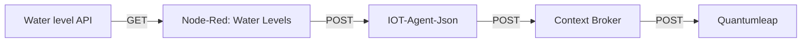

# Water Level API

## Specification and Setup

We utilize a Node-RED flow to periodically fetch data from the [water level API](https://pegel.eglv.de/gauges/). The flow is configured to filter the retrieved data for devices with IDs 10030, 10097, and 10109. We transform the data format before sending it to the IoT agent JSON.

The Node-RED flow listens for new data, processes it, and creates a POST request to the IoT agent JSON URL with the transformed parameters.

### Data Transformation

Original data format:

```json
{
  "Name": "Sonnenblumenweg, Kleingartenanlage",
  "Pegel-Nummer": "10109",
  "Fluss": "Dorneburger Mühlenbach",
  "Rechtswert": 374352.56,
  "Hochwert": 5709001.48,
  "Aktueller Trend": "Keine Daten",
  "latest_waterlevel": {
    "Datum": "25.10.2024 12:00",
    "Wert": 29,
    "Aktuelle Warnstufe": -1
  },
  "latest_discharge": {
    "Datum": "25.10.2024 12:00",
    "Wert": 0,
    "Aktuelle Warnstufe": null
  },
  "has_current_waterlevel": true,
  "has_current_discharge": true
}
```

Output format:

```json
{
  "address": "Sonnenblumenweg, Kleingartenanlage",
  "levelId": "10109",
  "name": "Dorneburger Mühlenbach",
  "location": {
    "type": "Point",
    "coordinates": [52.501765, 13.416569]
  },
  "dateWaterLevel": "25.10.2024 12:00",
  "waterLevel": 29,
  "waterLevelWarning": -1,
  "dateDischarge": "25.10.2024 12:00",
  "discharge": 0,
  "dischargeWarningLevel": null,
  "hasCurrentWaterLevel": true,
  "hasCurrentDischarge": true
}
```

We transform the UTM coordinates into a GeoLocation object, and the processed data is then posted to the IoT agent JSON.

### Provisioning and Setup

Once the Node-RED flow was established, we provisioned a new service and device with the specified attributes. The `init.sh` of the IoT agent JSON was modified, and we completed the setup by creating a new subscription with the context broker using a minimalist Node script.

## Attributes

| Attribute               | Type          |
| ----------------------- | ------------- |
| `address`               | `String`      |
| `dateDischarge`         | `DateTime`    |
| `dateWaterLevel`        | `DateTime`    |
| `discharge`             | `Float`       |
| `dischargeWarningLevel` | `Integer`     |
| `hasCurrentDischarge`   | `Boolean`     |
| `hasCurrentWaterLevel`  | `Boolean`     |
| `inactive`              | `Boolean`     |
| `levelId`               | `String`      |
| `location`              | `GeoLocation` |
| `name`                  | `String`      |
| `name`                  | `String`      |
| `waterLevel`            | `Float`       |
| `waterLevelWarning`     | `Integer`     |

## Context

With the types of the attributes a new context was created: [water-level-sensor](../../docker-compose/stack/context/custom/water-level-sensor.jsonld).

## Data Flow


