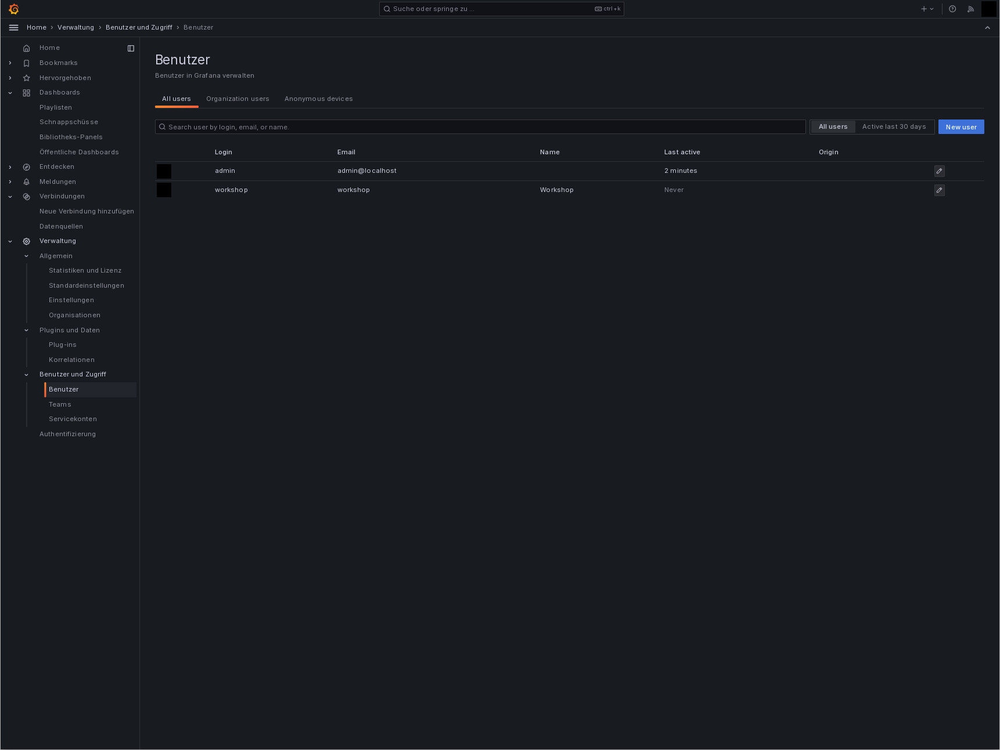
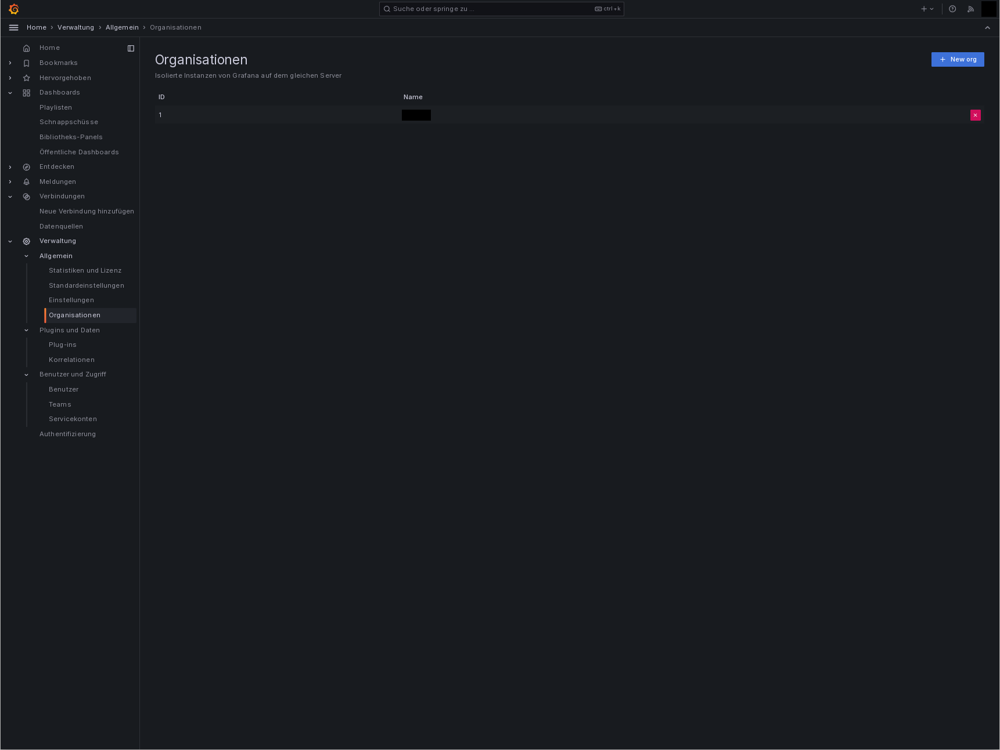
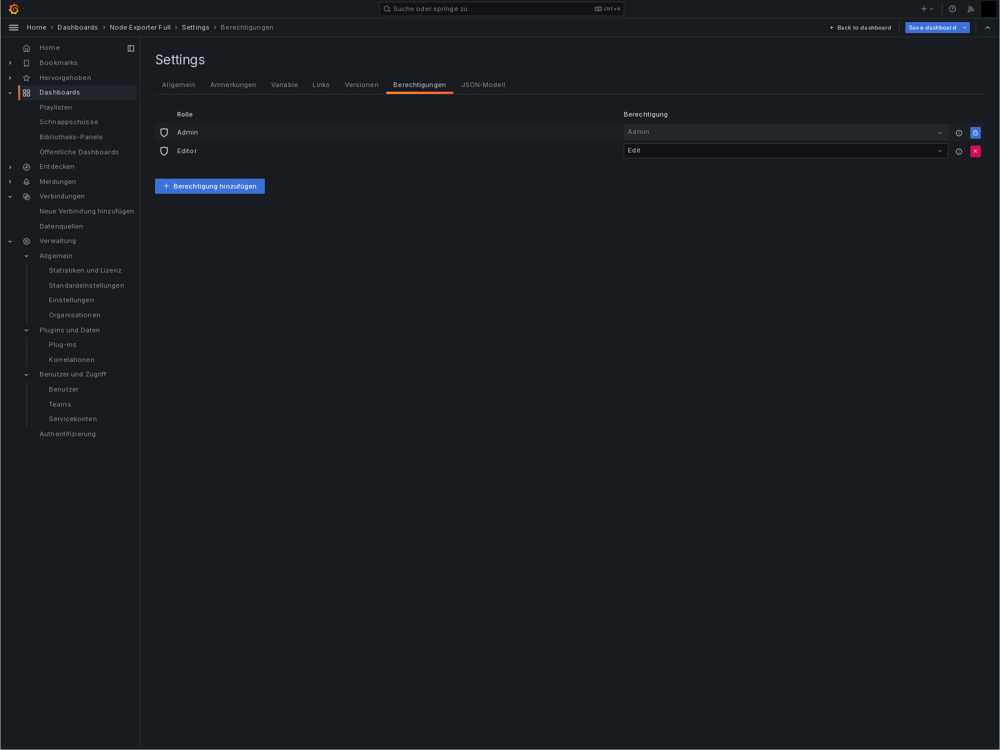
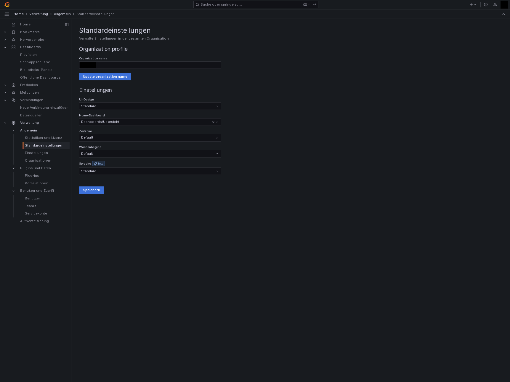

# Grafana

We use [grafana](https://grafana.com/) to visualize data collection by the sensors.
Each sensor group has its own dashboard.

Besides the sensor dashboards we added an overview as a landing page with a list of all available dashboards and some aggregated sensor values.

## Setup

Since grafana has little to no automation capabilities for setting up users and permissions but relies on external identity and access management solutions like an ldap server or [keycloack](https://www.keycloak.org/).
Since we decided to not add an access management solutions but manually add users, groups and permissions we have to supply those via the grafana admin interface.

| user     | role   |
| -------- | ------ |
| admin    | admin  |
| workshop | Editor |

Besides to users we have to manually change default organization:

But there is an [open issue](https://github.com/grafana/grafana/issues/2908) to automate this via the configuration and it might be resolved in `11.4`.

Now we can change the permissions of the KPI dashboard, so that only users with the `Editor ` or `Admin` role can access it:

We can finalize the configuration, by setting the overview dashboard as the home dashboard:

