# LoRaWAN

LoRaWAN is a wireless communication protocol. It uses different frequencies depending on the continent. A minimal LoRaWAN setup consists of three components:

- LoRaWAN Sensor (e.g. the weather station)
- LoRaWAN Gateway (e.g. the Dragino gateway)
- LoRaWAN Backend (e.g. the things network)

The communication between the sensor and the gateway is **not** encrypted. To add a new sensor to a gateway it has to be registered in the LoRaWAN Backend using the AppKey, AppId and DevId. The gateway polls the list of registered devices from the specified backend, and tries to establish a connection to the sensors. LoRaWAN allows two communication types:

- Uplink messages: from the device to the backend (e.g. heartbeats, status messages)
- Downlink messages: from the backend to the device (e.g. configuration, commands)

## LoRaWAN gateway

### Introduction

To connect the LoRaWAN sensors to TheThingsNetwork a gateway is needed. The gateway communicates with the sensors using a LoRaWAN connection that is **not** encrypted. The gateway send received data from sensors to TheThingsNetwork and vice versa.

### Initial setup

Following the manual we did reset the gateway, connected via WiFi and updated the firmware. Once that was done, the network and the TheThingsNetwork connection was setup on the device. Finally we could check the connection status in the gateway section of our TheThingsNetwork to show a updated status.

### Links

- [Product page](https://www.dragino.com/products/lora-lorawan-gateway/item/148-lps8.html)
- [User Manual](https://www.dragino.com/downloads/index.php?dir=LoRa_Gateway/LG02-OLG02/&file=LG02_LoRa_Gateway_User_Manual_v1.7.0.pdf)
- [Firmware Update](https://www.dragino.com/downloads/index.php?dir=LoRa_Gateway/LG02-OLG02/Firmware/)

## Devices

| Application | Device                   | AppEUI           | DevEUI           | AppKey                           |
| ----------- | ------------------------ | ---------------- | ---------------- | -------------------------------- |
| Parking     | Bosch parking lot sensor | A000000000000011 | A000000000000012 | `<AppKey>`                       |
| Parking     | Parking barrier          | A000000000000006 | A000000000000007 | `<AppKey>`                       |
| Field-test  | Ardeunis Field tester    | A000000000000002 | A000000000000001 | `<AppKey>`                       |
| Weather     | Libelium weather station | A000000000000010 | A000000000000004 | `<AppKey>`                       |

## MQTT integration

We can use the [mqtt integration](https://www.thethingsindustries.com/docs/integrations/mqtt/) of any application to receive updates.
Each device will publish its data once activated under:
`v3/{application id}@{tenant id}/devices/{device id}/up`

## Iot agent LoRaWAN

To integrate the LoRaWAN sensors into the firware stack we used the [iot-agent-lorawan](https://fiware-lorawan.readthedocs.io/en/latest/).

The provisioning for the devices is done in [init.sh](../../docker-compose/stack/iot-agent-lorawan-init/scripts/init.sh).

We had to decide if we would like to have a [configuration group or provision each device](https://github.com/Atos-Research-and-Innovation/IoTagent-LoRaWAN/blob/master/docs/users_manual.md). If a configuration group is used the LoRaWAN agent will auto provision each device added to the group.
Since we want to add additional properties like a location in the fiware context we decided to use device provisioning.

## Adeunis field tester

### Introduction

For administration and debugging tasks the adeunis field tester was added. It gathers data like signal strength and location.
The field tester uses OTAA authentication for join requests and implements the LoRaWAN specification 1.0.1 for Europe 863-870 MHz SF9 for RX2.

### Links

- [Product Page](https://www.adeunis.com/en/produit/ftd-network-tester/)
- [Datasheet](https://www.adeunis.com/wp-content/uploads/2024/01/Datasheet_FTD_AS923-US915-RC4_EN_09.24.pdf)
- [Manual](https://adeunis.notion.site/User-Guide-FIELD-TEST-DEVICE-LoRaWAN-US-902-928-00d3edb05f5c4423b3cc03454e4f0d08)
- [Enhanced manual but for firmware version 1.0.0](https://lora-alliance.org/wp-content/uploads/2019/07/FTD_LoRaWAN_AS923_UG_GB_V1.0.0.pdf)

### Retrieving the devices AppKey

Since the AppKey was not available it had to be retrieved via a USB serial terminal following chapter 5 of the 1.0.0 manual.

### Attributes

- battery: remaining battery level
- latitude: gps latitude of device
- longitude: gps longitude of device
- rssi: LoRaWAN reception signal strength in dB
- sats: number of available gps satellites
- snr: signal noise ratio
- temperature: measured temperature
- uplink: uplink packet count
- downlink: uplink packet count

### Payload Formatter

We added an uplink payload formatter to the end device to receive recorded data via TheThingsNetwork:

```js
function decodeUplink(input, port) {
  var data = {};

  var offset = 0;
  if (offset + 1 <= input.bytes.length) {
    var status = input.bytes[offset++]; // bitmask indicating the presence of the other fields
    if (status & 0x80 && offset + 1 < input.bytes.length) {
      // Temperature information (degree Celsius)
      var temperature = input.bytes[offset];
      if (temperature > 127) {
        temperature = temperature - 256;
      }
      data.temperature = temperature;
      offset += 1;
    }
    if (status & 0x40) {
      // Transmission triggered by the accelerometer
      data.trigger = "accelerometer";
    }
    if (status & 0x20) {
      // Transmission triggered by pressing the pushbutton
      data.trigger = "pushbutton";
    }
    if (status & 0x10 && offset + 9 <= input.bytes.length) {
      // GPS information
      var latDeg10 = input.bytes[offset] >> 4;
      var latDeg1 = input.bytes[offset] & 0x0f;
      var latMin10 = input.bytes[offset + 1] >> 4;
      var latMin1 = input.bytes[offset + 1] & 0x0f;
      var latMin01 = input.bytes[offset + 2] >> 4;
      var latMin001 = input.bytes[offset + 2] & 0x0f;
      var latMin0001 = input.bytes[offset + 3] >> 4;
      var latSign = input.bytes[offset + 3] & 0x01 ? -1 : 1;
      data.latitude =
        latSign *
        (latDeg10 * 10 +
          latDeg1 +
          (latMin10 * 10 +
            latMin1 +
            latMin01 * 0.1 +
            latMin001 * 0.01 +
            latMin0001 * 0.001) /
            60);
      var lonDeg100 = input.bytes[offset + 4] >> 4;
      var lonDeg10 = input.bytes[offset + 4] & 0x0f;
      var lonDeg1 = input.bytes[offset + 5] >> 4;
      var lonMin10 = input.bytes[offset + 5] & 0x0f;
      var lonMin1 = input.bytes[offset + 6] >> 4;
      var lonMin01 = input.bytes[offset + 6] & 0x0f;
      var lonMin001 = input.bytes[offset + 7] >> 4;
      var lonSign = input.bytes[offset + 7] & 0x01 ? -1 : 1;
      data.longitude =
        lonSign *
        (lonDeg100 * 100 +
          lonDeg10 * 10 +
          lonDeg1 +
          (lonMin10 * 10 + lonMin1 + lonMin01 * 0.1 + lonMin001 * 0.01) / 60);
      data.sats = input.bytes[offset + 8] & 0x0f; // number of satellites
      offset += 9;
    }
    if (status & 0x08 && offset + 1 <= input.bytes.length) {
      // Uplink frame counter
      data.uplink = input.bytes[offset];
      offset += 1;
    }
    if (status & 0x04 && offset + 1 <= input.bytes.length) {
      // Downlink frame counter
      data.downlink = input.bytes[offset];
      offset += 1;
    }
    if (status & 0x02 && offset + 2 <= input.bytes.length) {
      // Battery level information (mV)
      data.battery = (input.bytes[offset] << 8) | input.bytes[offset + 1];
      offset += 2;
    }
    if (status & 0x01 && offset + 2 <= input.bytes.length) {
      // RSSI (dBm) and SNR (dB) information
      data.rssi = -input.bytes[offset];
      var snr = input.bytes[offset + 1];
      if (snr > 127) {
        snr = snr - 256;
      }
      data.snr = snr;
      offset += 2;
    }
  }
  return {
    data: data,
  };
}
```

### Example decoded payload

```json
{
  "battery": 3878,
  "downlink": 21,
  "latitude": 52.52,
  "longitude": 13.405,
  "rssi": -61,
  "sats": 9,
  "snr": 7,
  "temperature": 29,
  "uplink": 21
}
```

## Live data

When everything was setup correct we can check the live data for that device:

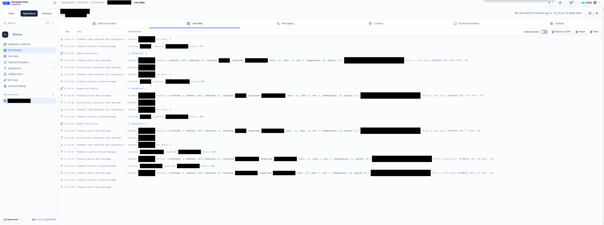

## Mocking data

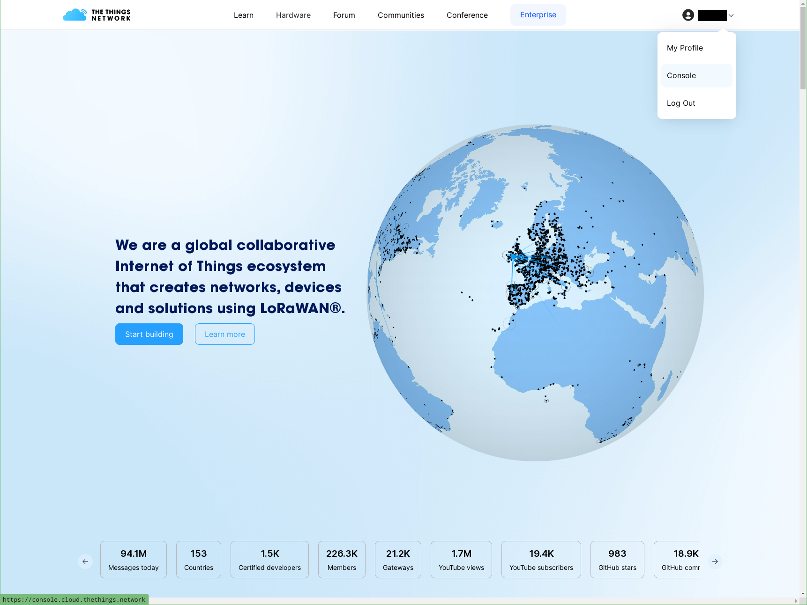

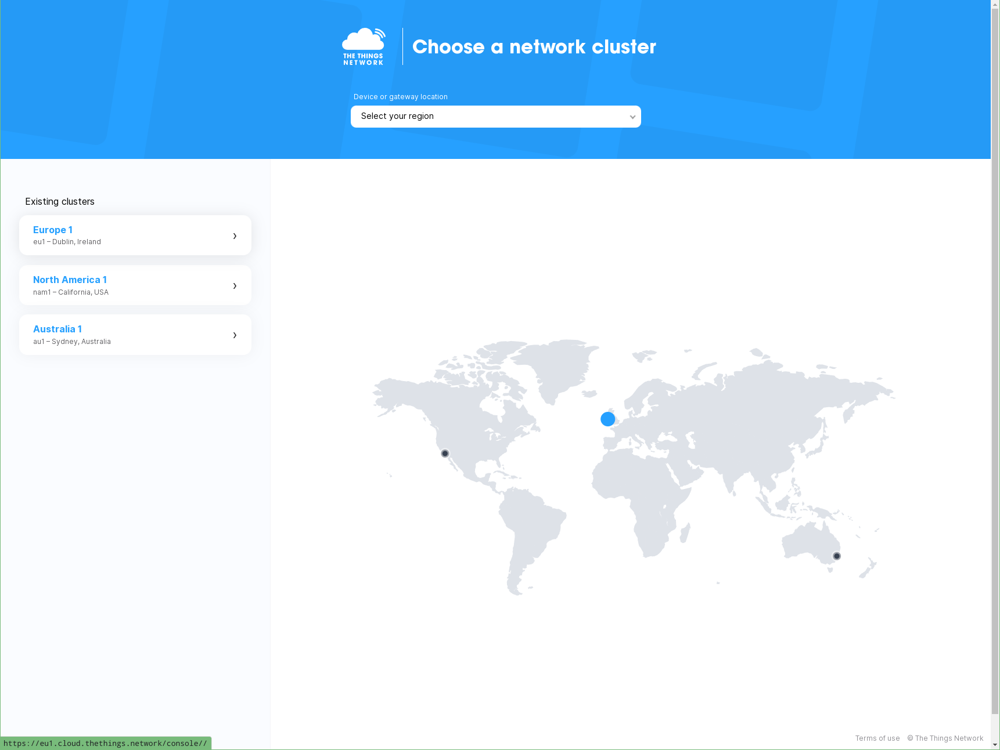

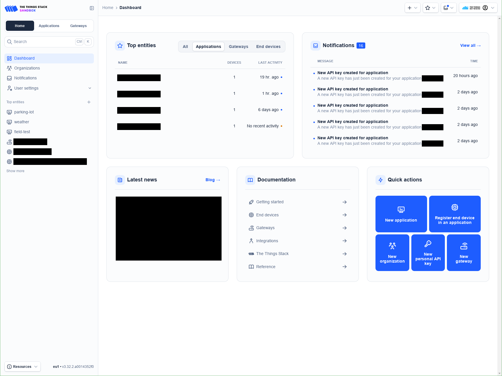

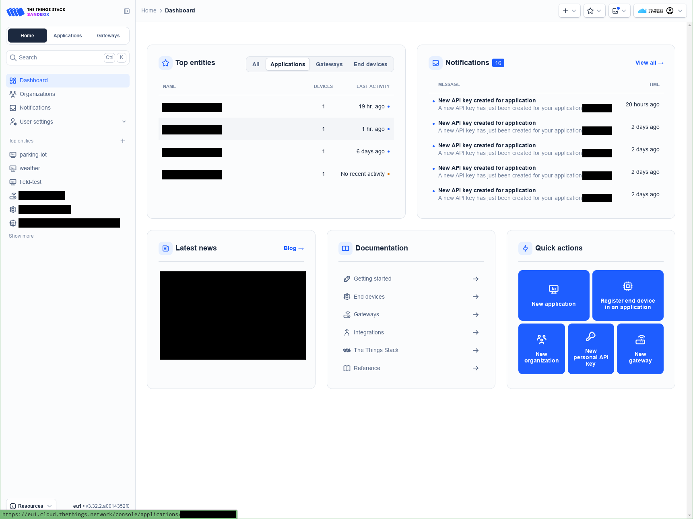

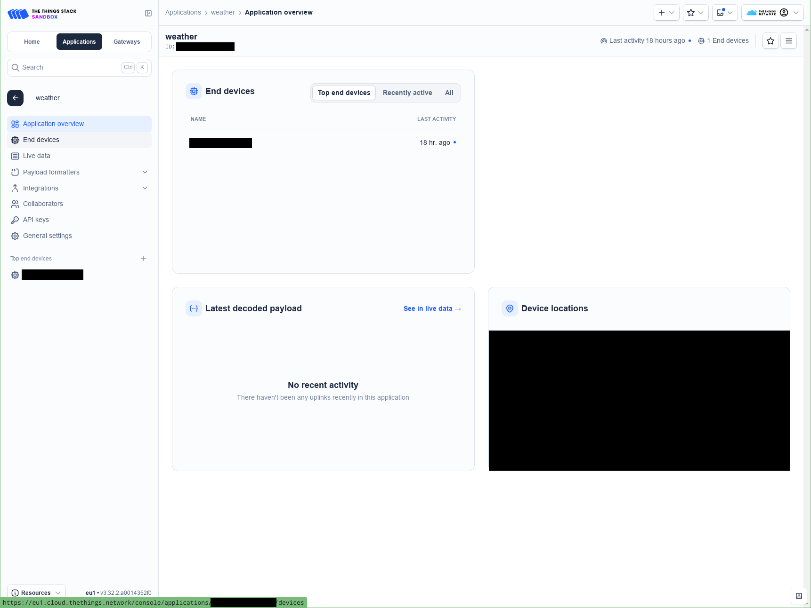

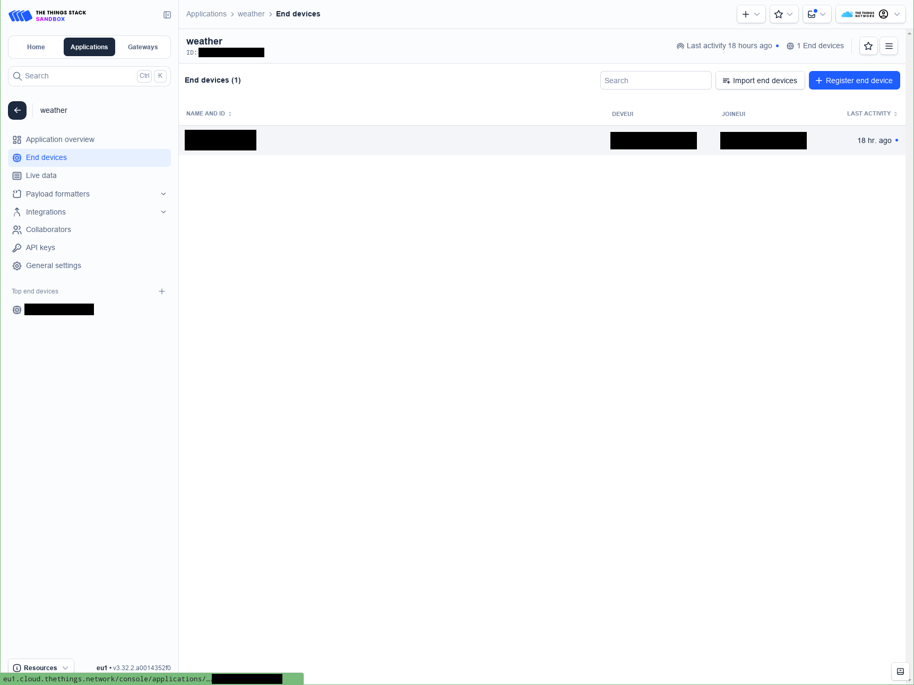

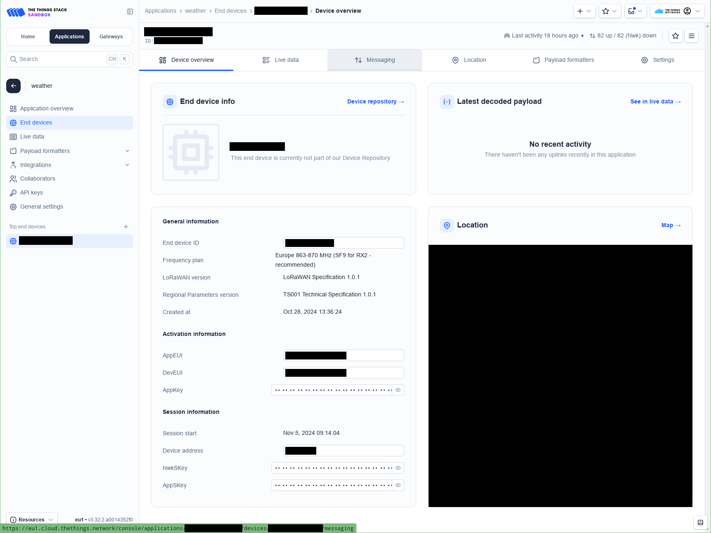

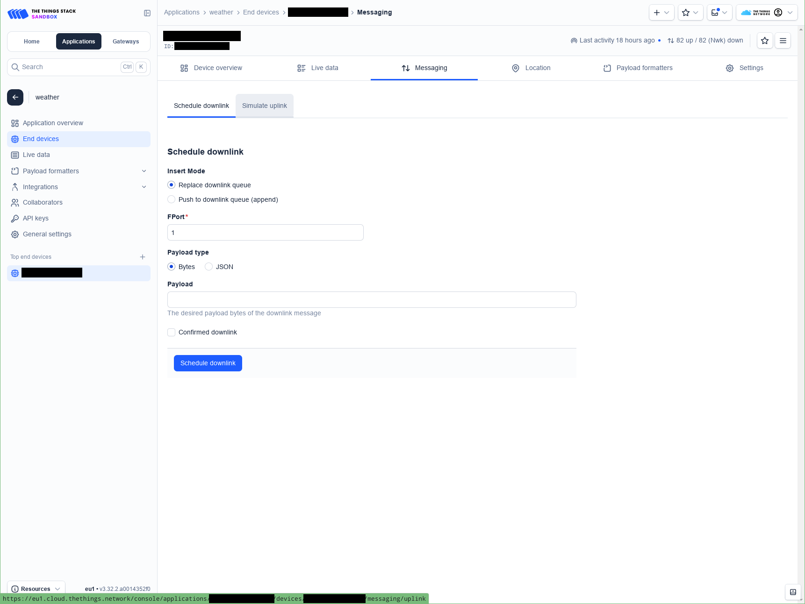

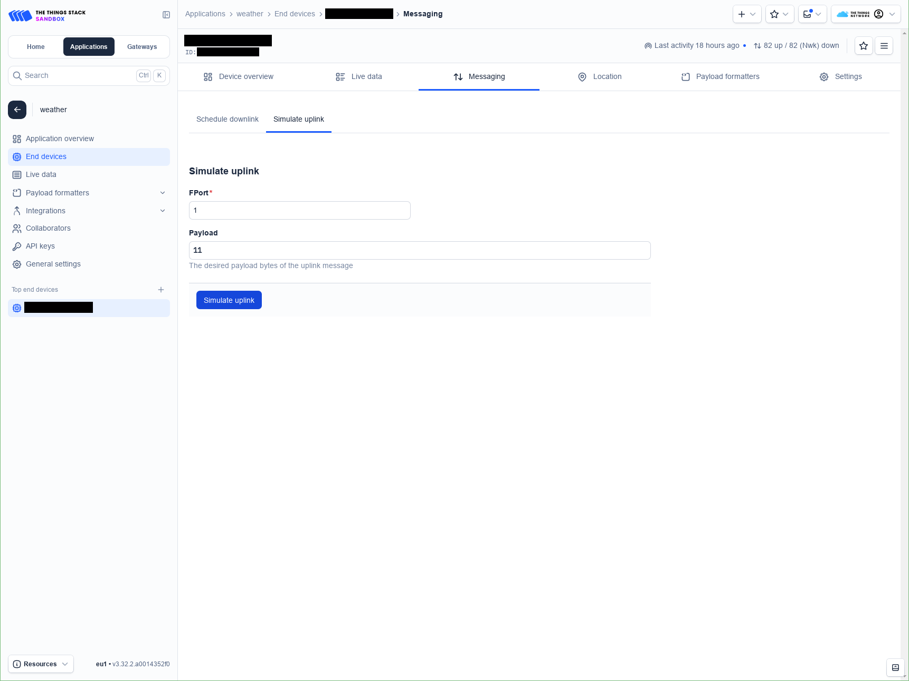

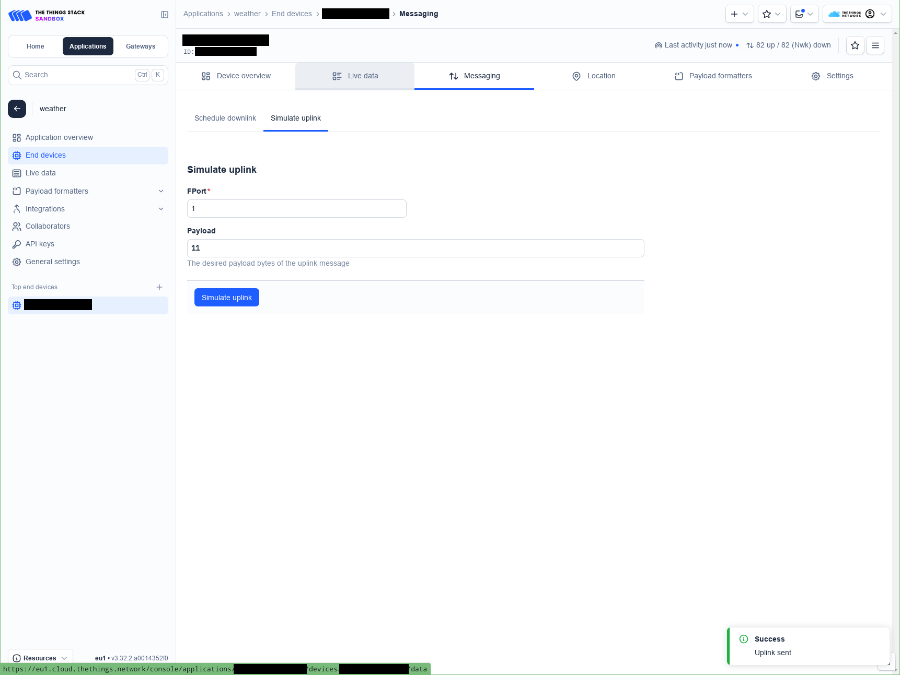

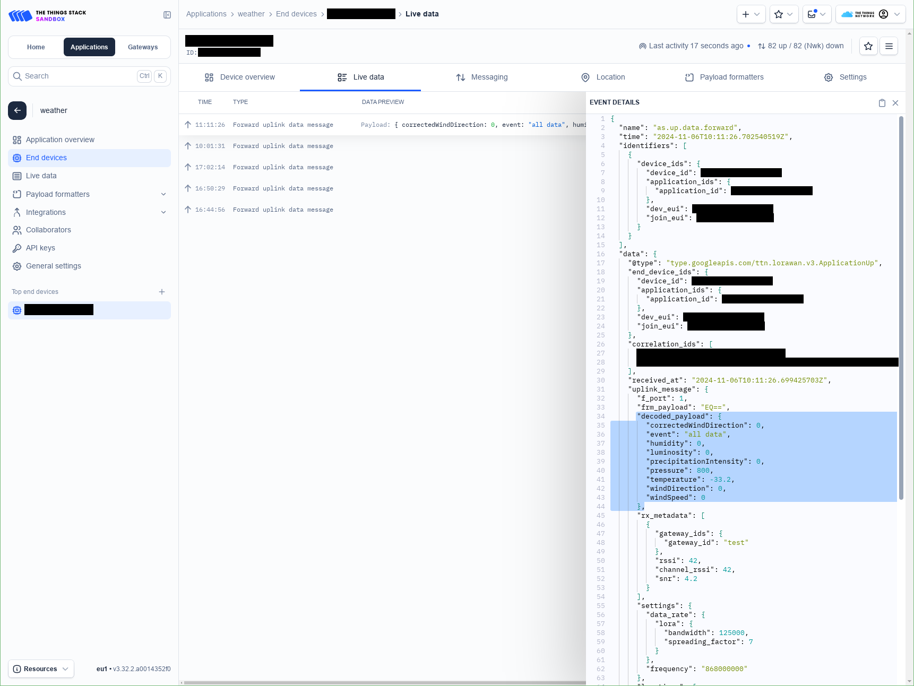
