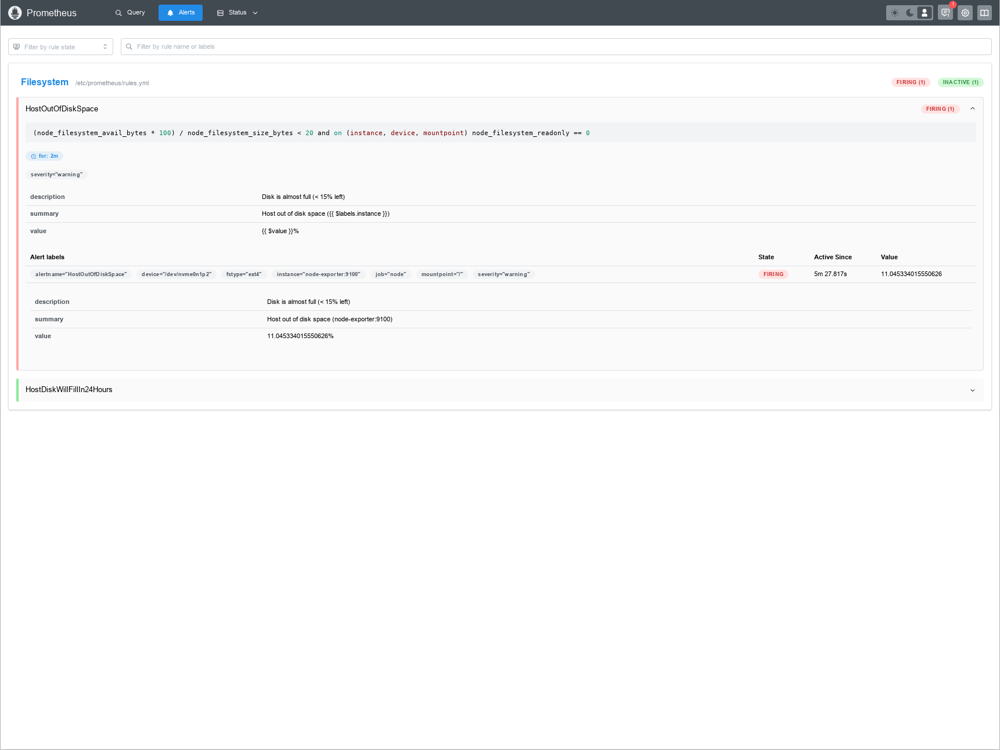
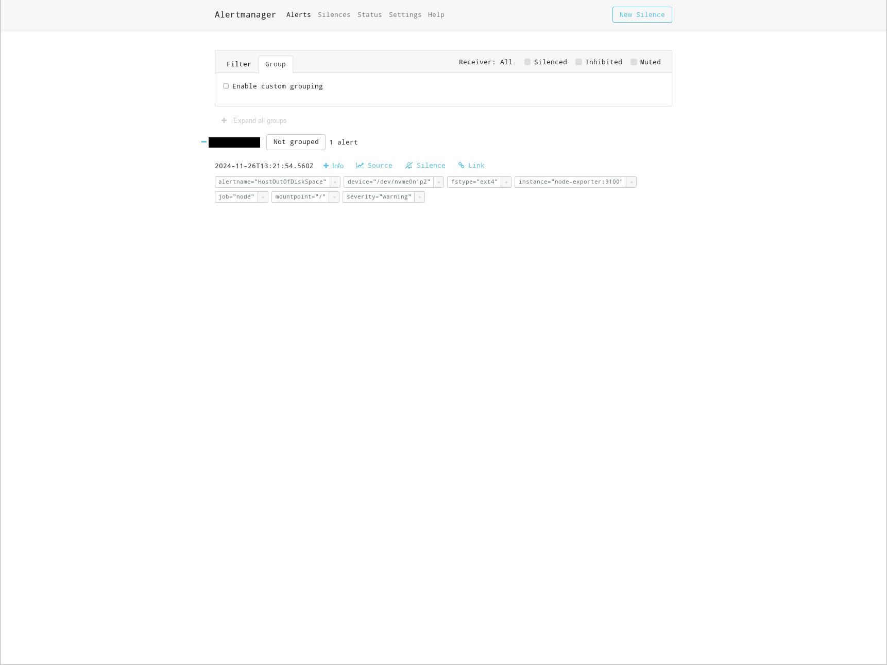
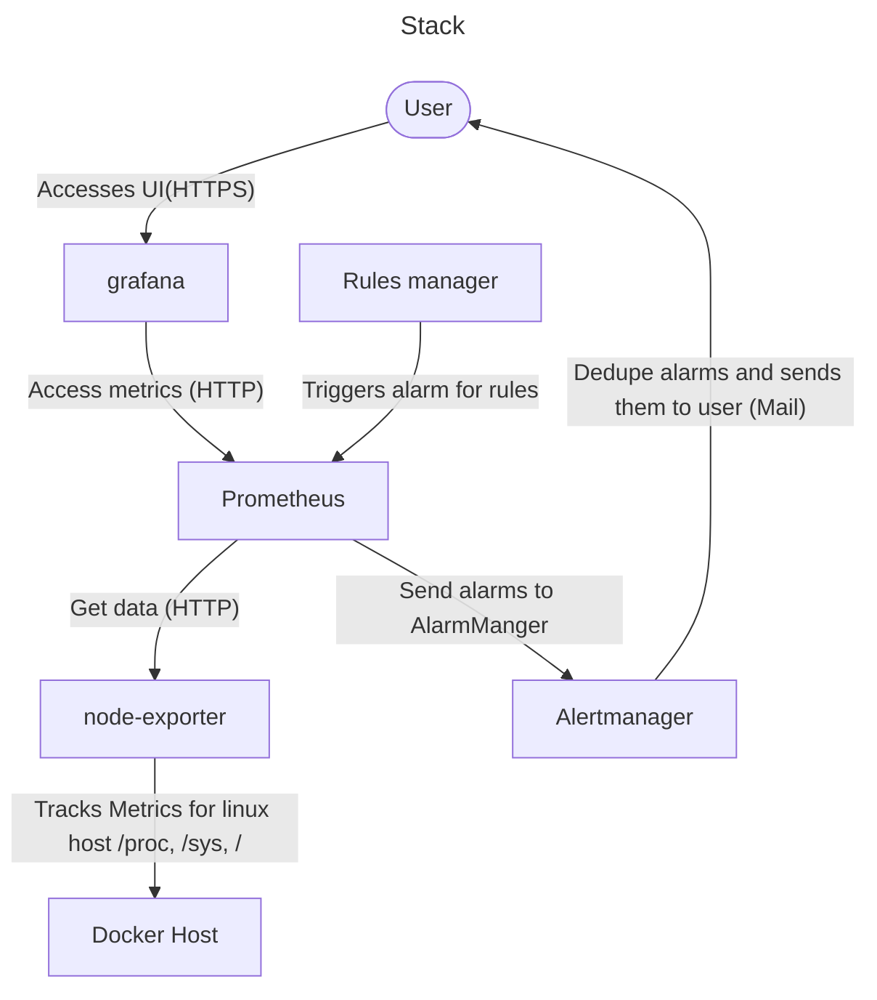

# Prometheus

[Prometheus](https://github.com/prometheus/prometheus) is a monitoring solution to track for example filesystem, memory and cpu usage on a host system.
To track these metrics for linux hosts there is the extension: [node-exporter](https://github.com/prometheus/node_exporter). If we would like to track usage on a windows host we can use [windows_exporter](https://github.com/prometheus-community/windows_exporter).

Prometheus comes with a [alert manager](https://prometheus.io/docs/alerting/latest/overview/) that can alert users for different rules via EMail.

## Dashboard

Prometheus comes with its own [dashboard](http://localhost:9091/query).

## Prometheus

Prometheus serves as a basis framework to collect data and organize various services like scaper, rules and alert managers.
We configured prometheus to use a set of predefined rules for the filesystem usage in `/prometheus/rules.yml`. There is a great collection of rules available [online](https://samber.github.io/awesome-prometheus-alerts/rules).

## Scraper

We configured prometheus to use the scraper `node-exporter` in `prometheus/prometheus.yml` to collection metrics for a linux host.
The data retention is defined via the command in the compose file via:

`storage.tsdb.retention.time=1d`. 15 days is the default duration and we changed it to 1 day.

## Alert manager

We configured prometheus to use the prometheus [alertmanager](https://github.com/prometheus/alertmanager) in `prometheus/prometheus.yml` to dedupe alarms and send them via EMail.
The Alertmanager is configured in `/alertmanager/alertmanager.yml`.
We added two rules to check the filesystem and trigger an alarm if there is only 15% left or prometheus predicts, the filesystem to be full in 24 hours. Both alarms are configured to be send once they are pending for at least 2 minutes.

### Dashboard

The Alertmanager comes with its own [dashboard](http://localhost:9093/#/alerts).

## EMail alert

Once the alert manager receives an alarm it will send a message via the configured cannel. We decided to use EMail, but there is also an discord, slack and pager integration.

# Flow

