# Smart City stack

## Architecture

```mermaid
---
title: Stack
---
graph TD
    subgraph JSON
        subgraph Http
            pegel-data
            froggit-wh-4000-se
            utility-load-data
            emissions-station --> |"GET Request(HTTP)"| elichen-api
        end
        subgraph LoRaWAN
            parksperre --> |"Send data(LoRaWAN)"| lorawan-gateway
            parksensor-bosch --> |"Send data(LoRaWAN)"| lorawan-gateway
            weatherstation-libelium --> |"Send data(LoRaWAN)"| lorawan-gateway
            lorawan-gateway --> |"Send command(LoRaWAN)"| parksperre
            the-things-network --> |"Send command(HTTP)"| lorawan-gateway
            lorawan-gateway --> |"POST JSON data(HTTP)"| the-things-network
            the-things-network --> |"Publish JSON data(MQTT)"| the-things-network-mqtt-broker
        end
    end

    subgraph UltraLight2
        klimaviertel --> |"Publish UL2 data (MQTT)"| mqtt-broker-external
        minitaure-house --> |"Publish UL2 data (MQTT)"| mqtt-broker-raspberry
    end
    subgraph Development
        data-mock -->|"Send mock data"| iot-agent-json
        data-mock -->|"Send mock data"| iot-agent-ul
        subgraph Production
            node-red --> |"Subscribe to UL2 data (MQTT)"| mqtt-broker-raspberry
            node-red --> |"Subscribe to UL2 data (MQTT)"| mqtt-broker-external
            node-red --> |"Publish UL2 data (MQTT)"| mqtt-broker
            froggit-wh-4000-se --> |"GET Request(HTTP)"| node-red
            utility-load-data --> |"Send as CSV(Mail)"| node-red
            node-red --> |"POST JSON Data(HTTP)"| iot-agent-json
            node-red --> |"Query data from api(HTTP)"| pegel-data
            node-red --> |"Query data from api(HTTP)"| elichen-api
            scorpio -->|"Send subscribed data(HTTP)"| quantumleap
            scorpio --> |"Gets context(HTTP)"| context-hoster
            scorpio -->|"Stores data(SQL)"| timescale-db-scorpio[(timescale-db-scorpio)]
            quantumleap -->|"Stores data(SQL)"| timescale-db-quantumleap[(timescale-db-quantumleap)]
            iot-agent-json --> |"Stores data(SQL)"| mongo-db[(mongo-db)]
            iot-agent-ul --> |"Stores data(SQL)"| mongo-db[(mongo-db)]
            subscription-init -->|"Creates subscriptions(HTTP)"| scorpio
            iot-agent-json-init -->|"Provisioning(HTTP)"| iot-agent-json
            iot-agent-ul-init -->|"Provisioning(HTTP)"| iot-agent-ul
            subgraph Provisioning
                subscription-init
                iot-agent-json-init
                iot-agent-ul-init
            end
            iot-agent-json --> |"POST JSON data(HTTP)"| scorpio
            iot-agent-lorawan --> |"POST JSON data(HTTP)"| scorpio
            iot-agent-lorawan --> |"Subscribe on JSON Data(MQTT)"| the-things-network-mqtt-broker
            iot-agent-ul --> |"POST JSON data(HTTP)"| scorpio
            iot-agent-ul --> |"Subscribe to device(MQTT)"| mqtt-server
            iot-agent-json --> |"Subscribe to Devices(MQTT)"| mqtt-server
            grafana -->|"Get data(SQL)"| timescale-db-quantumleap[(timescale-db-quantumleap)]
            krakenD <-->|"Calls the API(HTTP)"| scorpio
        end
    end
    user([User]) -->|"Accesses UI(HTTPS)"| grafana
    user <--->|"Calls the API(HTTP)"| krakenD
```

## Services

**scorpio (NGSI-LD Context Broker)**

Image: scorpiobroker/all-in-one-runner:java-5.0.3

- [Docker](https://hub.docker.com/r/scorpiobroker/all-in-one-runner)
- [Release Notes](https://github.com/ScorpioBroker/ScorpioBroker/releases)
- [Source Code](https://github.com/ScorpioBroker/ScorpioBroker)
- [Roadmap](https://github.com/ScorpioBroker/ScorpioBroker/blob/development-quarkus/docs/roadmap.md)
- [Documentation](https://scorpio.readthedocs.io/en/latest/)

**quantumleap (FIWARE Generic Enabler for timeseries databases)**

Image: orchestracities/quantumleap:1.0.0

- [Docker](https://hub.docker.com/r/orchestracities/quantumleap)
- [Release Notes](https://github.com/orchestracities/ngsi-timeseries-api/blob/master/RELEASE_NOTES.md)
- [Source Code](https://github.com/orchestracities/ngsi-timeseries-api)
- [Documentation](https://quantumleap.readthedocs.io/en/latest/)

**mongo-db (Document oriented NoSQL database)**

Image: mongo:7.0.14

- [Docker](https://hub.docker.com/_/mongo)
- [Release Notes](https://www.mongodb.com/docs/manual/release-notes/7.0/#std-label-release-notes-7.0)
- [Source Code](https://github.com/mongodb/mongo)
- [Documentation](https://www.mongodb.com/docs/manual/tutorial/install-mongodb-community-with-docker/)

**timescale-db-quantumleap (timeseries database built on top of PostgreSQL)**

Image: timescale/timescaledb-ha:pg13-ts2.15 (for quantumleap)

- [Docker](https://hub.docker.com/r/timescale/timescaledb-ha)
- [Release Notes](https://docs.timescale.com/about/latest/release-notes/)
- [Source Code](https://github.com/timescale/timescaledb-docker-ha/)
- [Documentation](https://docs.timescale.com/self-hosted/latest/install/installation-docker/)

**timescale-db-scorpio (timeseries database built on top of PostgreSQL)**

Image: timescale/timescaledb-ha:pg16.4-ts2.17.2 (for scorpio context broker)

- [Docker](https://hub.docker.com/r/timescale/timescaledb-ha)
- [Release Notes](https://docs.timescale.com/about/latest/release-notes/)
- [Source Code](https://github.com/timescale/timescaledb-docker-ha/)
- [Documentation](https://docs.timescale.com/self-hosted/latest/install/installation-docker/)

**grafana (analytics & monitoring solution)**

Image: grafana/grafana:11.3.0

- [Docker](https://hub.docker.com/r/grafana/grafana)
- [Release Notes](https://grafana.com/docs/grafana/latest/whatsnew/)
- [Source Code](https://github.com/grafana/grafana)
- [Documentation](https://grafana.com/docs/grafana/latest/setup-grafana/installation/docker/)

**mosquitto (message broker that implements the MQTT protocol)**

Image: eclipse-mosquitto:2.0.20

- [Docker](https://hub.docker.com/_/eclipse-mosquitto)
- [Release Notes](https://mosquitto.org/blog/categories/releases/)
- [Source Code](https://github.com/eclipse/mosquitto)
- [Documentation](https://mosquitto.org/documentation/)

**krakenD (high-performance open-source API Gateway.)**

Image: devopsfaith/krakend:2.7.2

- [Docker](https://hub.docker.com/r/devopsfaith/krakend)
- [Release Notes](https://github.com/krakend/krakend-ce/releases)
- [Source Code](https://github.com/krakend/krakend-ce)
- [Documentation](https://www.krakend.io/docs/overview/)

**traefik (Reverse Proxy)**

Image: traefik:3.1.6

- [Docker](https://hub.docker.com/_/traefik)
- [Release Notes](https://github.com/traefik/traefik/releases)
- [Source Code](https://github.com/traefik/traefik)
- [Documentation](https://doc.traefik.io/traefik/)

## Compose

We use two docker compose files that get merged for a development build with all containers exposed. To ensure changes in the compose files will result in updates or removal of services we start and stop containers with the [--remove-orphans](https://docs.docker.com/reference/cli/docker/compose/up/) flag.

We did not use any type of [anchors](https://docs.docker.com/compose/compose-file/10-fragments/) since it does not improve readability of the resulting docker compose file.

### Production

For the production build we used this features:

- [network](https://docs.docker.com/engine/network/) separation to mark services reachable from outside and strictly internal services
- [restart: always](https://docs.docker.com/engine/containers/start-containers-automatically/) policy to ensure services are always running

We did not use [docker secrets](https://docs.docker.com/compose/use-secrets/) since this feature is only fully supported for docker swarm and our solution to provide credentials to services only contains the needed the values and is safe.

### Setup Docker

- Windows (use Docker Desktop)
  - Enable & install WSL: https://learn.microsoft.com/en-us/windows/wsl/install
  - Install docker: https://docs.docker.com/desktop/install/windows-install/
    - Enable "Use WSL 2 instead of Hyper-V" option during setup
- Linux (use Docker Engine)
  - https://docs.docker.com/engine/install/ubuntu/
  - https://docs.docker.com/engine/install/linux-postinstall/#manage-docker-as-a-non-root-user
    - Execute the steps under "Manage Docker as a non-root user"

### Verify

Make sure docker runs with executing `docker run hello-world` in a terminal.

### Sources

The files to start the stack are in the folder `docker-compose/stack` of this repository.

### Configuration

Copy `docker-compose/stack/.env.example` to `docker-compose/stack/.env` and replace the placeholders with your own values. The file `.env` is ignored by git, so your credentials stay local.

### Starting the development stack

1. Execute in a terminal in the folder `docker compose -f docker-compose.yml -f docker-compose.development.yml up --build --remove-orphans -d`

- build and start stack
- restart if previously stopped
- update running services

2. Open `http://localhost:3000/` in your browser and navigate to the dashboard `Wetterstationen Froggit`
3. You should see a map and charts for the simulated weather station `WS001`

### Miscellaneous

There are additional commands to check the health and manage the started containers:

- `docker compose -f docker-compose/stack/docker-compose.yml -f docker-compose/stack/docker-compose.development.yml logs --follow` to see and follow logs from all services
- `docker compose -f docker-compose/stack/docker-compose.yml -f docker-compose/stack/docker-compose.development.yml ps` to see a list of all running services
- `docker compose -f docker-compose/stack/docker-compose.yml -f docker-compose/stack/docker-compose.development.yml stop` to stop the stack.
- `docker compose -f docker-compose/stack/docker-compose.yml -f docker-compose/stack/docker-compose.development.yml down --remove-orphans -v` to stop the stack and remove all data (reset the stack) including orphaned services
- `docker stats` to track cpu, mem usage and net I/O of the started containers.

## Useful links for FiWare

### Tutorials:

- [NGSI-ld](https://ngsi-ld-tutorials.readthedocs.io/en/latest/)
- [Video Courses](https://www.youtube.com/watch?v=b4sYU78skrw&list=PLARS-yIy9nOoBIOJS05Rpkvu1pZiNTgPT)

### Resources

- [FIWARE](https://github.com/Fiware)
- [FIWARE Catalogue (Open Source Components)](https://github.com/FIWARE/Catalogue/)
- [FIWARE Operations](https://github.com/FIWARE/Operations/)
- [FIWARE Awesome](https://github.com/FIWARE/Awesome/)
- [Smart Datamodels](https://github.com/smart-data-models)

## Workarounds

### Quantumleap

We had to change the implementation of version 1.0.0 of quantumleap since it always prefers bigint over of float for number without decimal places.
We decided to open an [issue with quantumleap](https://github.com/orchestracities/ngsi-timeseries-api/issues/778) and apply the changes in sql_translator.py. All changes are marked with `# changed`.
